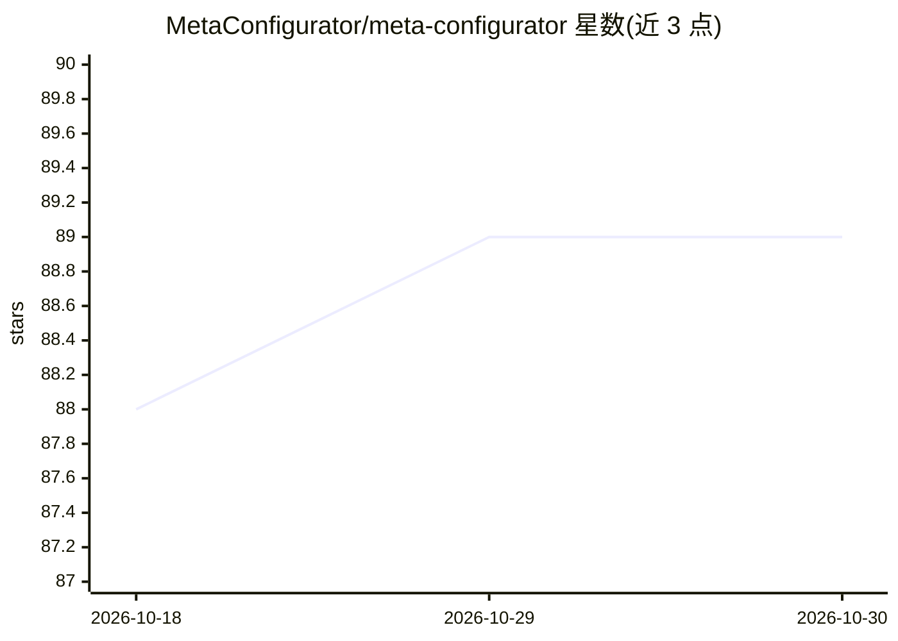

# MetaConfigurator/meta-configurator

⭐ 89 · TypeScript · MIT · 推送 2026-10-23 · [GitHub](https://github.com/MetaConfigurator/meta-configurator) · [官网](https://www.metaconfigurator.org) · 组织维护

**带 AI 辅助的浏览器端 JSON Schema 编辑器与表单/代码/文档生成器**

基于 Vue.js 与 PrimeVue 构建的浏览器端工具：通过图形界面创建和编辑 JSON Schema，按 schema 引导式编辑 JSON/YAML 数据，支持从 CSV 推断 schema、外部引用解析、基于 quicktype 的多语言代码生成、Markdown 文档生成、RDF 编辑与知识图谱可视化。AI 部分：自然语言辅助创建/编辑 schema 与数据、AI 生成映射函数后将实例数据确定性地转换到目标 schema、AI 辅助 RML 映射转 JSON-LD 及 SPARQL 查询。数据默认在本地浏览器处理，快照分享与高级导入需经斯图加特大学服务器，AI 功能可将数据子集发送至用户配置的端点（默认 Blablador）。面向技术与非技术用户，支持 JSON Schema Draft-2020-12。

## 筛选速览

| 维度 | 判定 | 备注 |
|---|---|---|
| AI 角色 | `ai-enhanced` | 去掉 AI 部分产品仍成立 |
| 许可风险 | `permissive` | MIT |
| 部署形态 | `library` | 以包/库形式分发 |
| 模型依赖 | — | README 未给出锁定关系 |
| 硬件要求 | — | 无带数字的原话,不猜 |
| 安装摩擦 | `low` | 无编译、无系统依赖或容器化 |
| 成熟度 | — | 结构信号不足 |

## 能力要点

- 图形化 JSON Schema 编辑与按 schema 引导的 JSON/YAML 数据编辑
- 基于 quicktype 从 schema 生成 Python/Rust/TypeScript/C++/Java 等代码
- AI 生成映射函数后确定性转换实例数据到目标 schema，支持大文档
- RDF 编辑面板、AI 辅助 SPARQL 查询与知识图谱可视化
- 浏览器本地运行，快照链接分享预配置的 schema、数据与设置

## 适用场景

- 需要图形化方式创建或编辑 JSON Schema 与配置文件
- 把现有数据转换成符合目标 schema 的结构
- 从 schema 批量生成代码骨架或 Markdown 文档
- 编辑与可视化 RDF/JSON-LD 语义数据

## 场景标签

`代码生成` `知识图谱` · 领域:编码与开发

## 证据(README 行号)

> L15: MetaConfigurator is a powerful, user-friendly JSON schema editor and form generator with AI assistance. It simplifi
> L63: * **AI-Assisted Schema/Data Creation and Editing** – Use AI to help create or edit schemas and instance data with n

## 星数曲线

2026-10-18 88 → 2026-10-30 89（+1）

---
*卡片 v1 · prompt 1.4 · 生成 2026-10-23 · 置信度 high · 依据 README sha `18ae49c25ed5` · [字段定义](../../DATASET.md)*
