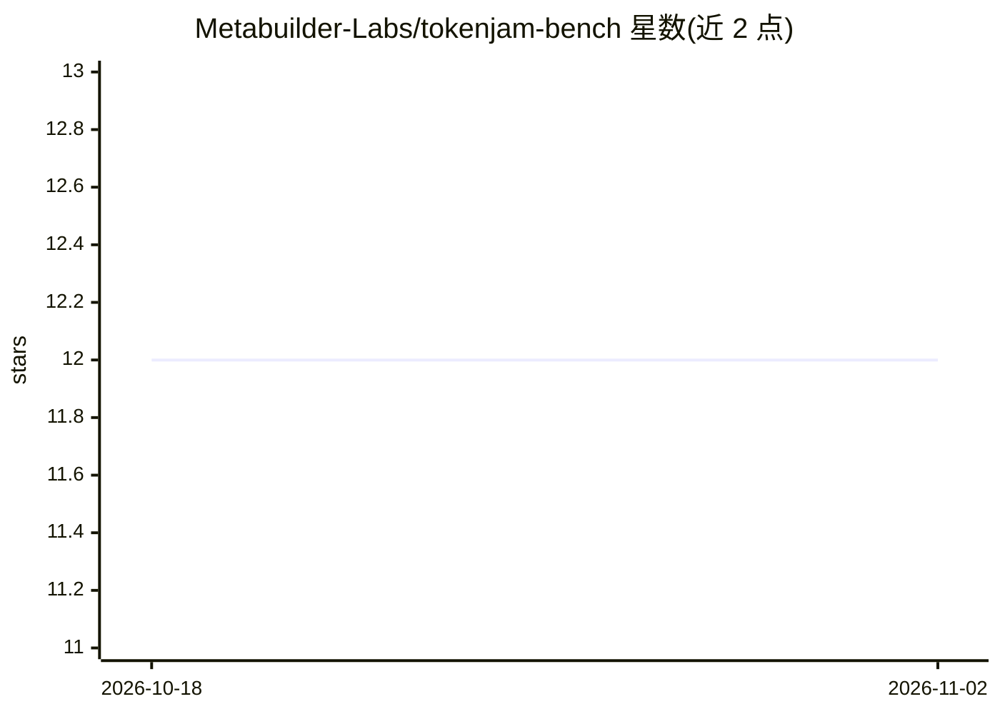

# Metabuilder-Labs/tokenjam-bench

⭐ 12 · Python · MIT · 推送 2026-08-09 · [GitHub](https://github.com/Metabuilder-Labs/tokenjam-bench) · [官网](https://tokenjam.dev/bench) · 组织维护

**验证 TokenJam 降档模型建议的本地基准评测工具**

面向使用 TokenJam（模型降档/降本推荐工具）的开发者的评测层：将原模型与 TokenJam 推荐的更便宜候选模型在同一基准套件上对跑，用 Wilson 置信区间、McNemar 精确配对检验等统计方法按套件分别给出精度差与成本差判定，工件带 TokenJam 版本戳。提供单发基准、agent 基准、真实遥测回放、跨版本矩阵对比与本地仪表盘五种模式。离线优先：无 API key 时自动进入 mock 模式；明确声明自己不是运行时安全认证，swe-bench-lite 评分未实现仅实验性脚手架。

## 筛选速览

| 维度 | 判定 | 备注 |
|---|---|---|
| AI 角色 | `ai-ecosystem` | LLM/agent 周边工具 |
| 许可风险 | `permissive` | MIT |
| 部署形态 | `library` | 以包/库形式分发 |
| 模型依赖 | — | README 未给出锁定关系 |
| 硬件要求 | — | 无带数字的原话,不猜 |
| 安装摩擦 | `low` | 无编译、无系统依赖或容器化 |
| 成熟度 | `idea` | |

## 能力要点

- 原模型 vs 候选模型成对对跑，输出 Δaccuracy（含 95% CI）与 Δcost
- McNemar 精确配对检验 + Wilson 置信区间 + pass@k，纯 Python 零统计依赖
- 回放自有 TokenJam 遥测（DuckDB/JSONL）验证候选模型与历史输出的一致性
- 跨 TokenJam 版本的证据矩阵，可作为 CI 回归守卫

## 适用场景

- 在采纳 TokenJam 降档建议前验证便宜模型是否在特定任务上退化
- 对比不同 TokenJam 版本发布间推荐结果与精度是否变化
- 用自己的历史会话回放检验降档候选的实际一致性

## 场景标签

`模型评测` · 领域:评测与运维

## 证据(README 行号)

> L3: ## Evidence-based Benchmarking & Evaluations for TokenJam recommendations
> L91: Diff proof artifacts across TokenJam releases. Flags accuracy regressions, savings shrinkage, and recommendation ch
> L170: - **pass@k** — unbiased Chen et al. 2021 estimator for multi-sample runs

## 星数曲线

2026-10-18 12 → 2026-11-02 12（+0）

---
*卡片 v1 · prompt 1.4 · 生成 2026-11-01 · 置信度 high · 依据 README sha `d324d6b15a61` · [字段定义](../../DATASET.md)*
