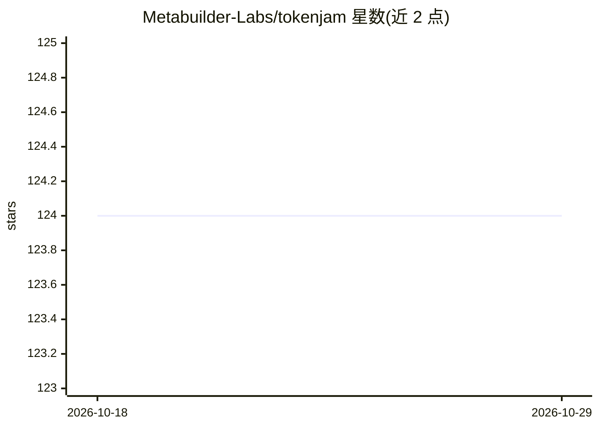

# Metabuilder-Labs/tokenjam

⭐ 124 · Python · MIT · 推送 2026-10-25 · [GitHub](https://github.com/Metabuilder-Labs/tokenjam) · [官网](https://tokenjam.dev/oss) · 组织维护

**读取 AI agent 遥测数据、定位 token 超额使用并给出修复建议的本地工具**

面向使用 Claude Code、Codex 或自研 SDK/API agent 的开发者的 token 效率分析工具：从多种 agent 运行时、框架与观测工具（含 OTLP、Langfuse、Helicone）摄取遥测数据，运行一组按 persona（编码 agent / SDK 代码）划分的分析器，找出昂贵模型误用、重复上下文、冗长输出等超支项并生成修复规则，结果在本地浏览器 dashboard（Lens）或 CLI 呈现。全部本地运行，无云端无注册。配套 TokenJam Bench 用于对比原模型与候选模型的通过率差异。

## 筛选速览

| 维度 | 判定 | 备注 |
|---|---|---|
| AI 角色 | `ai-ecosystem` | LLM/agent 周边工具 |
| 许可风险 | `permissive` | MIT |
| 部署形态 | `library` | 以包/库形式分发 |
| 模型依赖 | — | README 未给出锁定关系 |
| 硬件要求 | — | 无带数字的原话,不猜 |
| 安装摩擦 | `low` | 无编译、无系统依赖或容器化 |
| 成熟度 | — | 结构信号不足 |

## 能力要点

- 13 个分析器按 persona 划分，覆盖 downsize/cache/trim/verbosity/reuse 等超支类别
- 通过 OTLP 零代码摄取任意 OTel agent 的遥测数据
- Claude Code 插件与零 token 状态栏集成，支持历史回填
- TokenJam Bench 用 Wilson CI + McNemar 检验模型替换的通过率差异

## 适用场景

- 查看我的编码 agent 每天把 token 花在了哪里、哪些可回收
- 把 Opus 降到 Haiku 前先验证任务通过率是否受影响
- 对自研 SDK/API agent 做无侵入的 token 成本监控

## 场景标签

`LLM 可观测性` `模型评测` · 领域:评测与运维

## 证据(README 行号)

> L1: TokenJam: token efficiency for AI agents. Reads your agent
> L15: TokenJam ingests telemetry data about your agents from a multitude of sources and provides you a quick and easy way
> L87: TokenJam reads telemetry from the major agent runtimes, frameworks, providers, and observability tools,

## 星数曲线

2026-10-18 124 → 2026-10-29 124（+0）

---
*卡片 v1 · prompt 1.4 · 生成 2026-10-23 · 置信度 high · 依据 README sha `df531a306c7e` · [字段定义](../../DATASET.md)*
