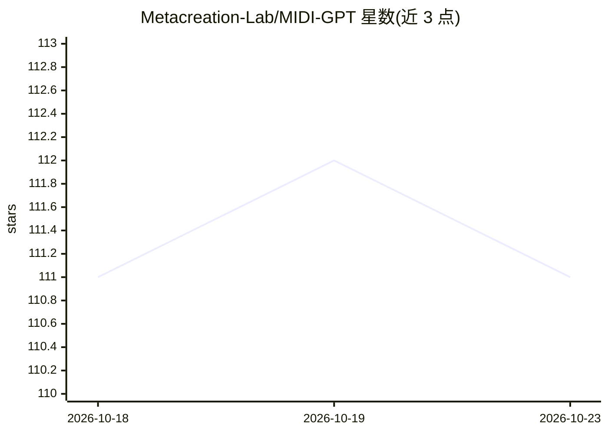

# Metacreation-Lab/MIDI-GPT

⭐ 111 · C++ · MIT · 推送 2026-10-20 · [GitHub](https://github.com/Metacreation-Lab/MIDI-GPT) · [官网](https://metacreation-lab.github.io/MIDI-GPT/) · 组织维护

**多轨符号音乐生成的 GPT-2 transformer 库，支持属性可控补全**

面向计算机辅助多轨音乐作曲的 Python 库：基于 GPT-2 架构生成 MIDI 符号音乐，可在保留现有编排的同时填充缺失小节、从零生成新音轨，并通过音符密度、复音数、时长、调性、音域、流派等量化属性全局或按小节控制输出。提供四行代码加载 HuggingFace Hub 预训练模型（无需编译器），另含 FastAPI HTTP 服务（流式/取消/多模型）与实时 OSC 服务，并支持用 PyTorch Lightning 训练。模型权重与代码分开授权，权重为非商业研究/教育许可。

## 筛选速览

| 维度 | 判定 | 备注 |
|---|---|---|
| AI 角色 | `ai-native` | 本体是模型或模型工具 |
| 许可风险 | `permissive` | MIT |
| 部署形态 | `library` | 以包/库形式分发 |
| 模型依赖 | — | README 未给出锁定关系 |
| 硬件要求 | — | 无带数字的原话,不猜 |
| 安装摩擦 | `high` | 编译与系统依赖俱全 |
| 成熟度 | — | 结构信号不足 |

## 能力要点

- 缺失小节填充与从零多轨生成，保留既有编排
- 音符密度/复音/时长/调性/音域/流派等属性控制（全局或按小节）
- 四种预训练模型，pip 一行安装且预编译 wheel 无需编译器
- HTTP API 服务器（流式 SSE、取消、多模型）与实时 OSC 服务器

## 适用场景

- 在已有 MIDI 编排中补全缺失小节或生成新音轨
- 按调性、密度、流派等属性约束生成音乐素材
- 通过 HTTP/OSC 接口把生成能力接入 DAW 或实时演出系统

## 场景标签

 · 领域:音乐生成/AI 作曲

## 证据(README 行号)

> L13: A transformer model for **computer-assisted multitrack music composition**.
> L16: - **Generate new tracks** from scratch, conditioned on musical attributes
> L17: - **Steer the output** with attribute controls (note density, polyphony, note duration, and on `prism`/`expressive`

## 星数曲线

2026-10-18 111 → 2026-10-23 111（+0）

---
*卡片 v1 · prompt 1.4 · 生成 2026-10-23 · 置信度 high · 依据 README sha `a42a65655812` · [字段定义](../../DATASET.md)*
