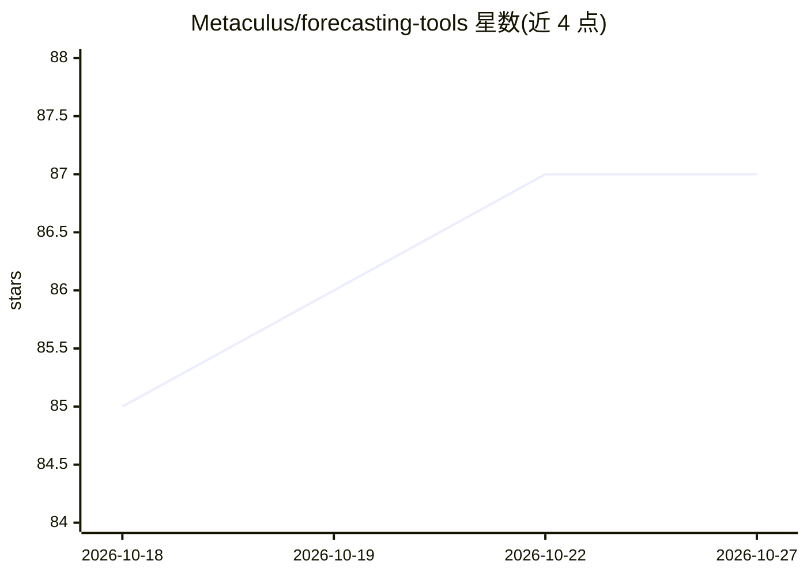

# Metaculus/forecasting-tools

⭐ 87 · Python · MIT · 推送 2026-10-23 · [GitHub](https://github.com/Metaculus/forecasting-tools) · 组织维护

**构建 Metaculus AI 预测机器人的 Python 框架与预测工具集**

Metaculus 官方维护的预测工具框架：提供预置的 Forecasting Bot（MainBot/TemplateBot），可对二元、多选、数值、日期类问题进行研究、生成多个独立预测并聚合为最终预测，可选发布到 Metaculus；用户可继承 TemplateBot 重写预测与研究方法。附带 Metaculus API 封装、基于 litellm 的统一 LLM 接口（重试、成本追踪、结构化输出）、MonetaryCostManager 费用管理与 Streamlit 前端。通过 pip 安装，可选 extras 提供更重依赖；包仍处实验阶段，API 稳定性无保证。

## 筛选速览

| 维度 | 判定 | 备注 |
|---|---|---|
| AI 角色 | `ai-ecosystem` | LLM/agent 周边工具 |
| 许可风险 | `permissive` | MIT |
| 部署形态 | `library` | 以包/库形式分发 |
| 模型依赖 | — | README 未给出锁定关系 |
| 硬件要求 | — | 无带数字的原话,不猜 |
| 安装摩擦 | `low` | 无编译、无系统依赖或容器化 |
| 成熟度 | `idea` | |

## 能力要点

- 预置 MainBot/TemplateBot，可继承重写预测与研究方法
- 基于 litellm 的 GeneralLlm 统一接口：重试、成本追踪、结构化输出（含 pydantic 类型校验）
- MetaculusClient 封装 API，支持问题/锦标赛交互与群组问题处理
- MonetaryCostManager 追踪 AI 与 API 花费上限

## 适用场景

- 快速搭建参加 Metaculus FutureEval 机器人锦标赛的预测机器人
- 对自定义问题生成带研究依据的概率预测
- 通过统一接口调用多模型并追踪预测任务成本

## 场景标签

 · 领域:AI 预测/预测平台工具

## 证据(README 行号)

> L18: - 🎯 **Forecasting Bot:** General forecaster that integrates with the Metaculus FutureEval bot tournament and provid
> L23: - **General LLM Wrapper:** A unified interface around litellm with retry logic, the Metaculus proxy, structured out
> L90: Generally all you have to do to make your own bot is inherit from the TemplateBot and override any combination of t

## 星数曲线

2026-10-18 85 → 2026-10-27 87（+2）

---
*卡片 v1 · prompt 1.4 · 生成 2026-10-23 · 置信度 high · 依据 README sha `58ed2bcdba11` · [字段定义](../../DATASET.md)*
