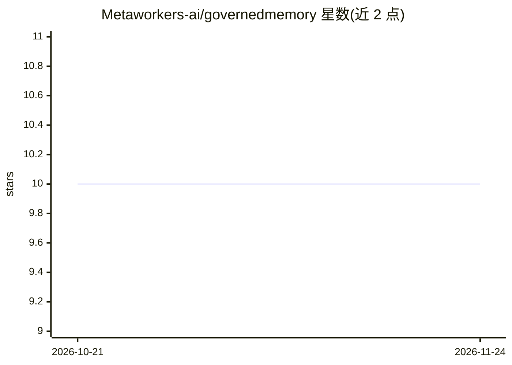

# Metaworkers-ai/governedmemory

⭐ 10 · Python · MIT · 推送 2026-08-06 · [GitHub](https://github.com/Metaworkers-ai/governedmemory) · [官网](https://demo.metaworkers.ai/) · 组织维护

**给企业 AI agent 提供带治理机制的内存层：防注入写入与审计**

面向企业 agent 的内存（memory）治理层：每条 memory 记录携带 provenance、信任标签、purpose binding 与防篡改审计链，检索时经权限门控默认排除 untrusted/quarantined 记录。写路径依次执行来源标注、注入扫描（启发式评分+训练分类器）、去重、嵌入与持久化；检索融合向量+词法结果。提供 Postgres+pgvector 存储、自托管 REST API、Python 客户端与 Next.js 控制台，MIT 开源核心，另提供企业集成支持与托管服务联系方式。

## 筛选速览

| 维度 | 判定 | 备注 |
|---|---|---|
| AI 角色 | `ai-ecosystem` | LLM/agent 周边工具 |
| 许可风险 | `permissive` | MIT |
| 部署形态 | `self-host` | docker 或自建部署 |
| 模型依赖 | — | README 未给出锁定关系 |
| 硬件要求 | — | 无带数字的原话,不猜 |
| 安装摩擦 | `low` | 无编译、无系统依赖或容器化 |
| 成熟度 | — | 结构信号不足 |

## 能力要点

- 写路径全流程治理：provenance→注入扫描→去重→嵌入→持久化
- 检索权限门控：默认排除 untrusted/quarantined 记录并强制 purpose binding
- hash-chain 防篡改审计图，支持 provenance 溯源与级联清除
- REST API + Python SDK + Docker 一键启动的本地部署栈

## 适用场景

- 为多租户 agent 系统做 memory 隔离与用途限定检索
- 拦截通过钓鱼邮件等渠道注入的 prompt 注入式 memory 写入
- 金融/保险等合规场景要求 memory 操作留有防篡改审计记录
- 接入现有 Mem0 OSS 应用并叠加治理策略

## 场景标签

`Agent 记忆` `网络安全` · 领域:Agent 开发

## 证据(README 行号)

> L8: A governed memory layer for enterprise AI agents. Every memory record carries provenance, trust labels, purpose bind
> L21: **Current status:** E1 + E2 + E3 + E4 + E5 + E6 + E7 complete — core data models, Postgres+pgvector store, a Write 

## 星数曲线

2026-10-21 10 → 2026-11-24 10（+0）

---
*卡片 v1 · prompt 1.4 · 生成 2026-11-20 · 置信度 mid · 依据 README sha `99886122a909` · [字段定义](../../DATASET.md)*
