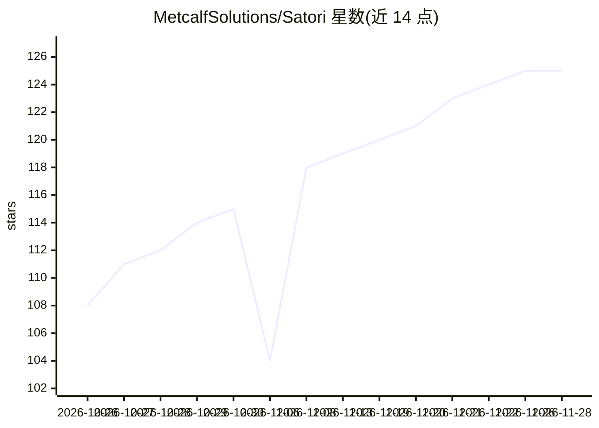

# MetcalfSolutions/Satori

⭐ 125 · Python · Apache-2.0 · 推送 2026-11-23 · [GitHub](https://github.com/MetcalfSolutions/Satori) · [官网](https://metcalf.solutions/satori/) · 个人维护

**面向成年人内省对话的 Claude Code 技能：反思式陪伴而非建议**

以 Claude Code 技能形式分发的反思式对话配置：聚合 18 种哲学与心理传统的视角，按每轮最多一种视角（One Lens Per Turn）+ 一个开放问题的方式回应，内省主题之外（纯代码/DevOps）保持不激活。记忆为本地 SQLite vault（~/.satori/memory/），另设三层危机风险门与 9 条地区危机转介。通过 npx 安装于 CLI/IDE agent，也提供 zip 用于网页聊天、Compact 版用于本地模型。声明为治疗的辅助而非替代。

## 筛选速览

| 维度 | 判定 | 备注 |
|---|---|---|
| AI 角色 | `ai-native` | 本体是模型或模型工具 |
| 许可风险 | `permissive` | Apache-2.0 |
| 部署形态 | `desktop` | 安装包/桌面程序 |
| 模型依赖 | — | README 未给出锁定关系 |
| 硬件要求 | — | 无带数字的原话,不猜 |
| 安装摩擦 | `low` | 无编译、无系统依赖或容器化 |
| 成熟度 | — | 结构信号不足 |

## 能力要点

- One Lens Per Turn：每轮最多一个哲学/心理学视角且零建议
- 纯代码提示 200 例 98.0% 不激活（350 例触发基准）
- 本地 SQLite 记忆库，零云端遥测，POSIX 权限限制
- 三层风险门区分存在性绝望与急性危机并转介

## 适用场景

- 在 CLI/IDE 中与 AI 对话时不打断编码工作流
- 写代码之余处理职业倦怠、丧失或关系冲突话题
- 在本地/开源自托管模型上运行紧凑版反思技能

## 场景标签

`AI 助手` · 领域:对话与助手

## 证据(README 行号)

> L12:  Psychologically Grounded Wisdom Companion for Inner Life
> L13:  18 Philosophical &amp; Contemplative Traditions · 6-Step Reflective Model · 9 Immovables · Local SQLite Memory Vau
> L14:  Built to be outgrown: Satori helps you see clearly enough to return to human relationships and human care. If it w

## 星数曲线

2026-10-26 108 → 2026-11-28 125（+17）

---
*卡片 v1 · prompt 1.4 · 生成 2026-11-28 · 置信度 high · 依据 README sha `61d858566154` · [字段定义](../../DATASET.md)*
