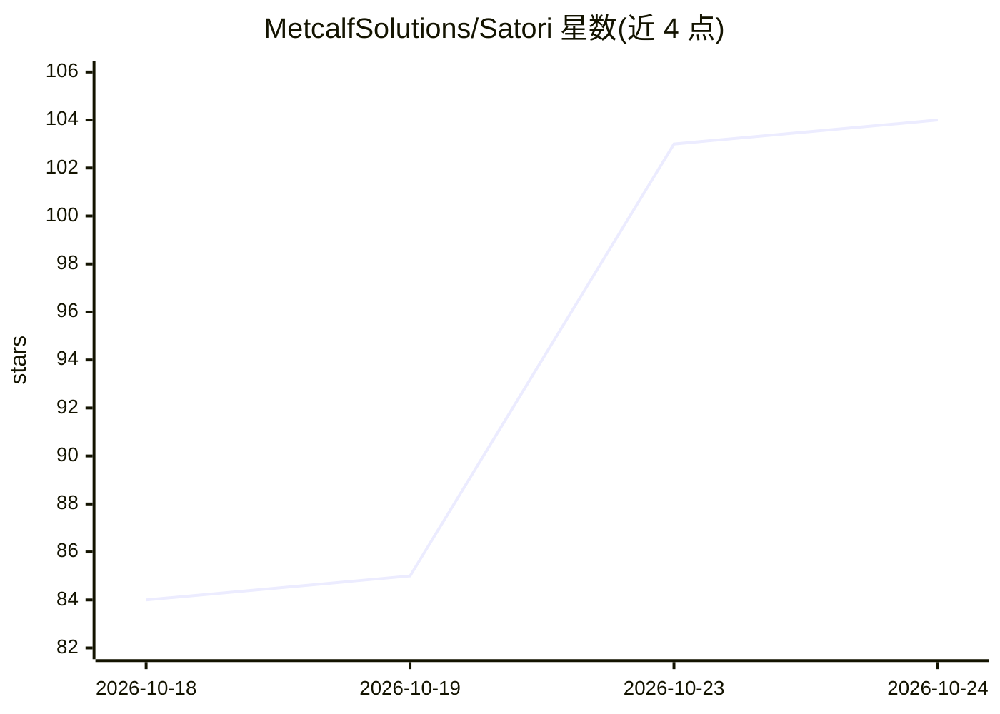

# MetcalfSolutions/Satori

⭐ 104 · Python · Apache-2.0 · 推送 2026-10-23 · [GitHub](https://github.com/MetcalfSolutions/Satori) · [官网](https://metcalfsolutions.github.io/Satori/) · 组织维护

**跨 agent 的心理洞察对话技能：给开发者与普通用户的内省对话伙伴**

以 SKILL.md 及 15 个按需引用分片形式发布的 agent 技能包，可在 Claude Code、Cursor、Windsurf、Codex 等编码 agent 及 Claude.ai/ChatGPT/Gemini 网页与本地 Ollama/LM Studio 模型上运行，提供基于心理学传统的内省式对话。采用渐进披露架构（Turn-1 负载<8KB），配本地 SQLite 记忆库（可选 AES-256-GCM 加密）、350 用例触发基准与分级危机安全协议（SAFETY.md）。声明零遥测、本地优先，并明确‘不是治疗师’。安装经 npx skills add 一条命令完成。

## 筛选速览

| 维度 | 判定 | 备注 |
|---|---|---|
| AI 角色 | `ai-native` | 本体是模型或模型工具 |
| 许可风险 | `permissive` | Apache-2.0 |
| 部署形态 | `desktop` | 安装包/桌面程序 |
| 模型依赖 | local-ok | 支持本地模型 |
| 硬件要求 | — | 无带数字的原话,不猜 |
| 安装摩擦 | `low` | 无编译、无系统依赖或容器化 |
| 成熟度 | — | 结构信号不足 |

## 能力要点

- 单命令安装到多种编码 agent（Claude Code/Cursor/Windsurf/Antigravity/Codex）
- Full 与 Compact 两种版本，Compact 支持 ChatGPT Custom GPT 与本地开源权重模型
- 本地 SQLite 记忆库（~/.satori/），可选 AES-256-GCM 口令加密
- 分级危机边界协议（SAFETY.md）与 350 用例触发基准

## 适用场景

- 在编码 agent 中获得不劫持工作流的内省对话伙伴
- 在 Claude.ai/ChatGPT/Gemini 网页端配置深度对话人格
- 本地开源权重模型（8B-32B）上离线使用

## 场景标签

 · 领域:AI 对话/心理健康辅助

## 证据(README 行号)

> L12:  A wisdom companion that tells you the truth, kindly. Free, open-source, not a therapist.
> L24: > - **End-Users (Web Chat & Custom GPTs):** Want a perceptive conversation partner in Claude.ai, ChatGPT, or Gemini
> L25: > - **Developers & Founders (CLI & IDE Agents):** Run `npx skills add MetcalfSolutions/Satori` in Quick Start & Ins

## 星数曲线

2026-10-18 84 → 2026-10-24 104（+20）

---
*卡片 v1 · prompt 1.4 · 生成 2026-10-23 · 置信度 mid · 依据 README sha `c043983b5b75` · [字段定义](../../DATASET.md)*
