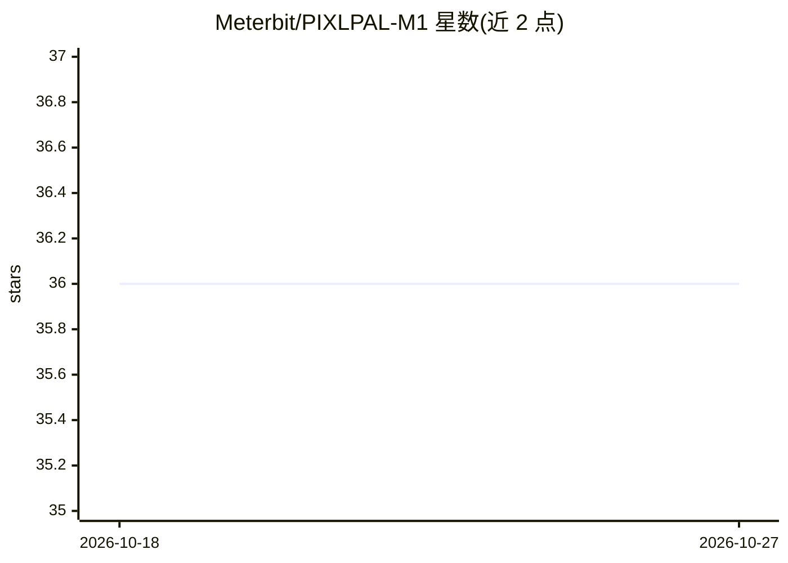

# Meterbit/PIXLPAL-M1

⭐ 36 · C · NOASSERTION · 推送 2026-09-26 · [GitHub](https://github.com/Meterbit/PIXLPAL-M1) · [官网](https://meterbitcyb.com) · 组织维护

**ESP32-S3 桌面 AIoT 伴侣机器人（RGB LED 矩阵屏）的固件**

Meterbit Cybernetics 的 Pixlpal-M1 固件，运行于 ESP32-S3（N16R8）之上，驱动 128×64 RGB LED 矩阵显示。基于 ESP-IDF 框架并结合 Arduino 库，各应用以独立 FreeRTOS 任务运行，经 BLE 由手机 App 启动，可实现时钟、日历、股票/加密货币行情、AI 对话助手及多种 API 集成。支持 Wi-Fi/BLE、I2S 音频输入输出、USB-OTG、双模式 OTA。限制：必须 PSRAM、仅 BLE 5.0、无电池管理。构建依赖 ESP-IDF v5.5.X，需自行编译烧录。

## 筛选速览

| 维度 | 判定 | 备注 |
|---|---|---|
| AI 角色 | `ai-enhanced` | 去掉 AI 部分产品仍成立 |
| 许可风险 | `none` | NOASSERTION |
| 部署形态 | `None` |  |
| 模型依赖 | — | README 未给出锁定关系 |
| 硬件要求 | — | 无带数字的原话,不猜 |
| 安装摩擦 | `low` | 无编译、无系统依赖或容器化 |
| 成熟度 | — | 结构信号不足 |

## 能力要点

- FreeRTOS 任务化的模块化应用框架，经 BLE 远程启动
- 支持文本/图形/GIF/PNG/SVG 绘制与 I2S 音频输入输出
- GitHub 在线与 U 盘离线双模式 OTA 更新
- 集成 PicoMQTT，计划支持 Home Assistant 与 ESP Matter

## 适用场景

- 为 Pixlpal AIoT 显示硬件烧录和扩展固件应用
- 参考其 ESP-IDF+Arduino 混合架构开发联网视觉应用
- 制作带 AI 对话助手的桌面交互显示设备

## 场景标签

`聊天机器人` · 领域:对话与助手

## 证据(README 行号)

> L4: Pixlpal is a smart AIoT desktop companion featuring an interactive 128×64 RGB LED matrix display.
> L8: The firmware demonstrates how to build network-enabled visual applications such as clocks, calendars, stock/crypto t
> L14: - **ESP32-S3 Target** – Optimized for neural network acceleration and signal processing.

## 星数曲线

2026-10-18 36 → 2026-10-27 36（+0）

---
*卡片 v1 · prompt 1.4 · 生成 2026-10-25 · 置信度 high · 依据 README sha `ca6021ebd842` · [字段定义](../../DATASET.md)*
