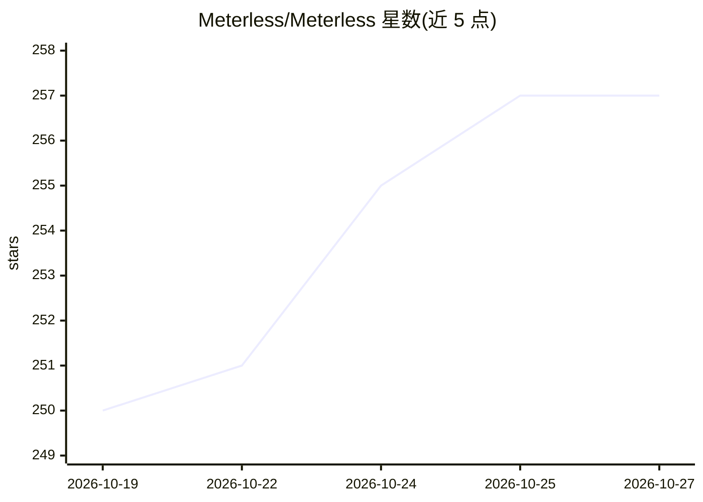

# Meterless/Meterless

⭐ 257 · TypeScript · Apache-2.0 · 推送 2026-10-19 · [GitHub](https://github.com/Meterless/Meterless) · [官网](https://meterless.ai) · 组织维护

**本地多模型夜间竞跑系统：闲置计算机批量生成并通过校验筛选结果**

面向拥有本地硬件（Windows 独显 PC、Apple Silicon Mac、NVIDIA DGX Spark）的用户的产品：夜间将同一任务跨多个本地模型跑数百次尝试，由 scribe 模型摘要标记、聚类成不同方案，经裁判模型、校验器、浏览器沙箱与媒体检查评分，只保留通过检查的文件并附签名回执；白天同一机器可作为 OpenAI API 兼容的 AI 热点供 Cursor、Claude Code 等应用调用。多版本：浏览器免费版、Windows 版已发售、Mac M1+ 免费下载、Mac M5 版为 $199 预购（2026 Q4 交付）。仓库另含四个开放上下文引擎（H-MEM、World Model、Markovian Engine、Scout Intent），以 AGENTS.md 规格加参考实现与一致性测试套件提供。无模型重训练；夜间成果以 insight pack 形式续用。

## 筛选速览

| 维度 | 判定 | 备注 |
|---|---|---|
| AI 角色 | `ai-native` | 本体是模型或模型工具 |
| 许可风险 | `permissive` | Apache-2.0 |
| 部署形态 | `library` | 以包/库形式分发 |
| 模型依赖 | — | README 未给出锁定关系 |
| 硬件要求 | — | 无带数字的原话,不猜 |
| 安装摩擦 | `medium` | 含编译或系统依赖之一 |
| 成熟度 | — | 结构信号不足 |

## 能力要点

- 跨多个本地模型夜间竞跑数百次尝试并聚类去同质化
- 裁判模型、校验器、浏览器沙箱与媒体检查的多层验收，附签名回执
- 白天作为 OpenAI API 兼容端点供任意应用调用
- 四个开放上下文引擎以 AGENTS.md 规格+参考实现+一致性套件提供

## 适用场景

- 让闲置的 Mac 或独显 PC 夜间批量生成并自动校验交付物（备忘录、3D 模型、HTML 应用等）
- 把本地机器当作 OpenAI API 兼容的模型端点供 Cursor / Claude Code 使用
- 基于开放上下文引擎规格在自有技术栈中构建记忆与长程推理能力

## 场景标签

`Agent 记忆` `模型网关` `编码 Agent` · 领域:Agent 开发

## 证据(README 行号)

> L5: Your Mac, Windows PC or DGX Spark answers your apps while you work, then races hundreds of attempts at the jobs you 
> L92: 7. **Your AI hotspot.** Any app that speaks the OpenAI API can send its requests to the same machine.
> L156: Everything above runs on four open context engines: memory, state, long-run reasoning and intent routing. Each one

## 星数曲线

2026-10-19 250 → 2026-10-27 257（+7）

---
*卡片 v1 · prompt 1.4 · 生成 2026-10-22 · 置信度 mid · 依据 README sha `5c20ba2716f0` · [字段定义](../../DATASET.md)*
