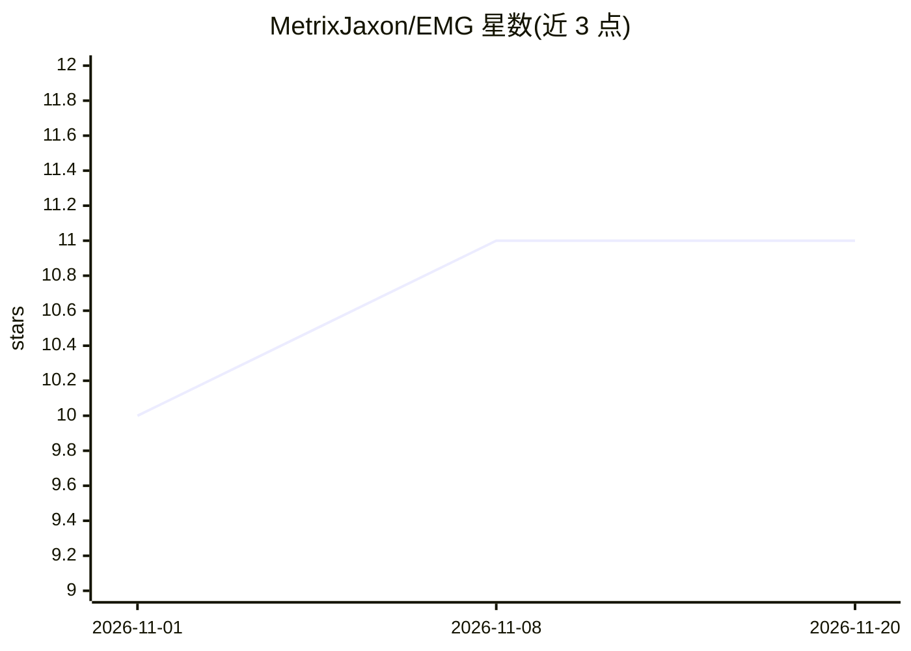

# MetrixJaxon/EMG

⭐ 11 · Python · 推送 2026-05-09 · [GitHub](https://github.com/MetrixJaxon/EMG) · 个人维护

**面向无线信号调制识别研究者，提供 EMG 层与 EMGNet 的论文复现代码**

论文《Energy-Modulated Gain: A Sufficient-Statistic Approach to Automatic Modulation Recognition》的官方 PyTorch 实现：提出基于标准化对数能量的条件归一化层 EMG，嵌入多尺度膨胀残差主干构成 EMGNet。仓库统一训练入口覆盖 RML2016.10a、RML2018.01a、HisarMod2019 三个基准，附带 ResNet、MCLDNN、PET-CGDNN、AMC-Net、IQFormer 五个基线实现、能量消融（Full/No-energy）CLI 开关，以及按 SNR/类别的 F1、召回、精确率、准确率指标计算脚本。数据集需用户自行下载后以 --data_path 指定路径。

## 筛选速览

| 维度 | 判定 | 备注 |
|---|---|---|
| AI 角色 | `ai-native` | 本体是模型或模型工具 |
| 许可风险 | `none` | — |
| 部署形态 | `library` | 以包/库形式分发 |
| 模型依赖 | — | README 未给出锁定关系 |
| 硬件要求 | — | 无带数字的原话,不猜 |
| 安装摩擦 | `medium` | 含编译或系统依赖之一 |
| 成熟度 | — | 结构信号不足 |

## 能力要点

- EMG 条件归一化层与 EMGNet 的完整 PyTorch 实现
- 内置五个基线模型（ResNet/MCLDNN/PET-CGDNN/AMC-Net/IQFormer）与统一训练协议
- 三个公开基准的数据加载、缓存与确定性划分
- Full/No-energy 能量消融与按 SNR/类别的指标报告脚本

## 适用场景

- 在 RML2016/2018、HisarMod2019 上复现论文表格中的精度数字
- 以统一协议训练对比五个调制识别基线模型
- 消融实验验证能量注入机制本身的贡献
- 计算 per-SNR 与 per-class 的 F1/召回/精确率指标

## 场景标签

`科研工具` `模型训练` `模型评测` · 领域:评测与运维

## 证据(README 行号)

> L3: This repository contains the official PyTorch implementation of the paper
> L10: We translate these requirements into **Energy-Modulated Gain (EMG)**, a lightweight conditional-normalization layer

## 星数曲线

2026-11-01 10 → 2026-11-20 11（+1）

---
*卡片 v1 · prompt 1.4 · 生成 2026-11-19 · 置信度 high · 依据 README sha `ab24107a1dd2` · [字段定义](../../DATASET.md)*
