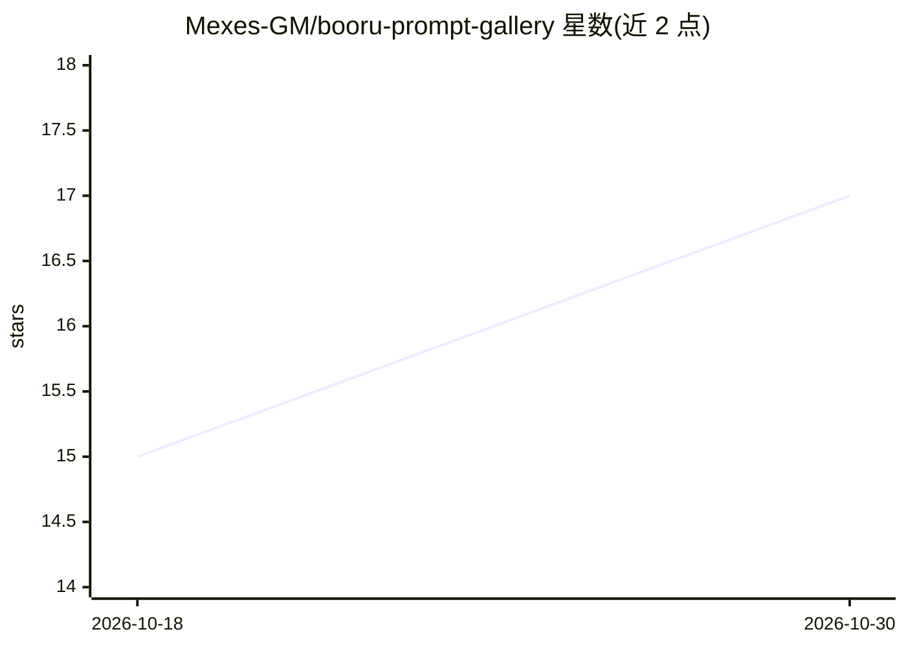

# Mexes-GM/booru-prompt-gallery

⭐ 17 · TypeScript · AGPL-3.0 · 推送 2026-10-28 · [GitHub](https://github.com/Mexes-GM/booru-prompt-gallery) · [官网](https://booru-prompt-gallery.vercel.app/) · 个人维护

**聚合五家 booru 站图片并生成可直接使用的 AI 绘画提示词**

基于 Next.js/TypeScript 的多图源画廊应用：从 Danbooru、Gelbooru、e621、Aibooru、Rule34 拉取帖子，抽取 booru 标签并清洗（去除画师名、元数据、水印类标签），合并冗余、按 180+ 冲突规则排除矛盾标签，再按 7 大类 33 子类组织，一键复制为 Illustrious、Pony、SDXL 等模型可用的提示词。附带 Merge、Pack Mode、AI Convert（标签转自然语言）等模式。自部署需 Node.js 24.12+、npm 及配套 Cloudflare Worker；仅 Worker URL 为必填环境变量，Supabase、Redis 等均可选。约 14.5 万 Danbooru 标签由 Jev AI 模型分类，歧义项交由用户 Quick Teach 校正。

## 筛选速览

| 维度 | 判定 | 备注 |
|---|---|---|
| AI 角色 | `ai-ecosystem` | LLM/agent 周边工具 |
| 许可风险 | `viral` | AGPL-3.0 |
| 部署形态 | `library` | 以包/库形式分发 |
| 模型依赖 | — | README 未给出锁定关系 |
| 硬件要求 | — | 无带数字的原话,不猜 |
| 安装摩擦 | `low` | 无编译、无系统依赖或容器化 |
| 成熟度 | — | 结构信号不足 |

## 能力要点

- 五站聚合（Danbooru/Gelbooru/e621/Aibooru/Rule34）+ 约 14.5 万 Danbooru 标签自动补全
- 标签清洗：去除画师名/元数据/限制性标签，合并冗余、180+ 冲突排除规则
- 7 大类 33 子类标签分类体系，支持按类别复制、Merge 与 Pack Mode 批量生成提示词
- AI Convert 将标签提示词转为自然语言（每日 10 次免费，可填自有 API key）

## 适用场景

- 测试自己训练的 LoRA/checkpoint 时快速取用干净提示词
- 按角色、服装、姿势组合拼装提示词并一键复制到生成器
- 批量围绕基础提示词生成一批变体提示词

## 场景标签

`提示工程` · 领域:Agent 开发

## 证据(README 行号)

> L15: I make LoRAs and checkpoints, and I was spending way too much time writing prompts to test them. Booru sites like D
> L17: You search for a character, an outfit, a pose or anything else, scroll through real posts, and copy a prompt with o

## 星数曲线

2026-10-18 15 → 2026-10-30 17（+2）

---
*卡片 v1 · prompt 1.4 · 生成 2026-10-30 · 置信度 high · 依据 README sha `566539ac2ed9` · [字段定义](../../DATASET.md)*
