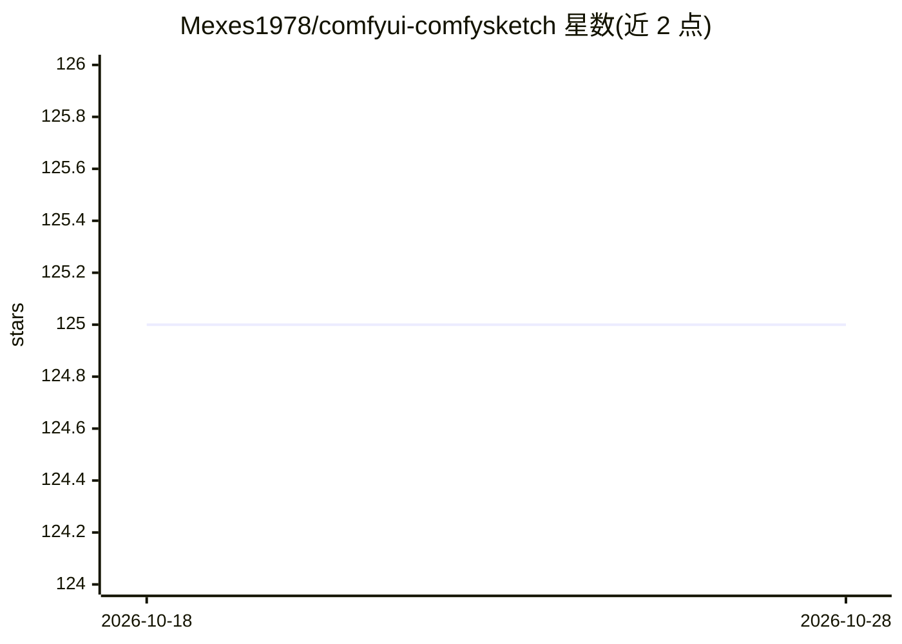

# Mexes1978/comfyui-comfysketch

⭐ 125 · JavaScript · MIT · 推送 2026-03-13 · [GitHub](https://github.com/Mexes1978/comfyui-comfysketch) · 个人维护

**ComfyUI 的绘图/草稿画板节点，供手绘输入图像**

ComfyUI 自定义节点：在 ComfyUI 内提供全屏绘图编辑器，支持 8 种工具（画笔/铅笔/直线/圆/矩形/填充/橡皮/取色）、4 种笔刷（圆头/柔边/喷枪/喷雾）、HSV 色轮与 HSL/RGB 滑块、多图层（透明度/可见性/合并/重排）、镜像对称绘制、预设画布尺寸（512×512 至 1920×1080 及自定义）、撤销重做与明暗主题。绘制的图像以 tensor（BHWC）输出，可连接到其他节点（如 Stable Diffusion 工作流）。安装方式为将仓库文件夹复制到 custom_nodes/ 目录后重启。README 声明部分代码由 AI 辅助工具开发后手工调整，且与 ComfyUI 项目无隶属关系。

## 筛选速览

| 维度 | 判定 | 备注 |
|---|---|---|
| AI 角色 | `ai-ecosystem` | LLM/agent 周边工具 |
| 许可风险 | `permissive` | MIT |
| 部署形态 | `None` |  |
| 模型依赖 | — | README 未给出锁定关系 |
| 硬件要求 | — | 无带数字的原话,不猜 |
| 安装摩擦 | `low` | 无编译、无系统依赖或容器化 |
| 成熟度 | — | 结构信号不足 |

## 能力要点

- 8 种绘图工具与 4 种笔刷类型，支持压感与快捷键
- 多图层管理（透明度、可见性、合并、重排、重命名）
- 输出 BHWC tensor，可连接 ComfyUI 其他节点
- 镜像对称绘制与自定义画布尺寸（含 1920×1080）

## 适用场景

- 在 ComfyUI 工作流中手绘草图作为图像生成或编辑的输入
- 用图层分离元素进行分步绘制与修改
- 配合 img2img 等节点手绘控制画面构图

## 场景标签

 · 领域:AI 图像生成/绘图工具

## 证据(README 行号)

> L3: A drawing and sketching node for ComfyUI with layers, multiple brush types, and a focused, professional interface.
> L130: 1. Add the **ComfySketch** node (found in `image` category)

## 星数曲线

2026-10-18 125 → 2026-10-28 125（+0）

---
*卡片 v1 · prompt 1.4 · 生成 2026-10-23 · 置信度 high · 依据 README sha `c2081cbd6a5b` · [字段定义](../../DATASET.md)*
