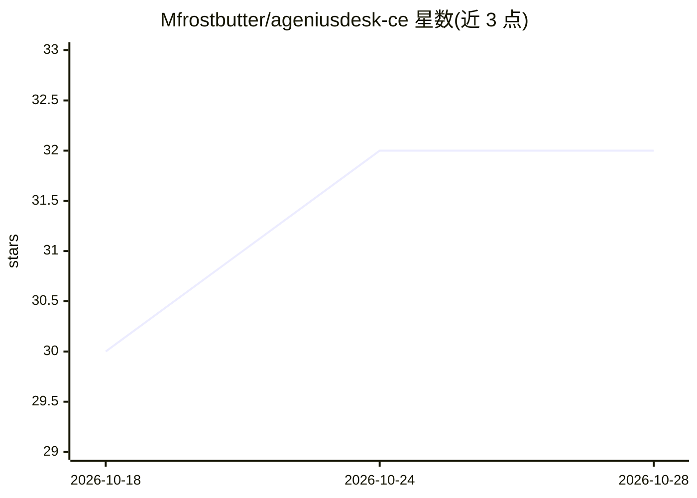

# Mfrostbutter/ageniusdesk-ce

⭐ 32 · Python · MIT · 推送 2026-09-29 · [GitHub](https://github.com/Mfrostbutter/ageniusdesk-ce) · 个人维护

**n8n 自动化运维者的自托管控制平面：多实例管理与错误追踪**

面向 n8n 自动化运营者的开源控制平面：通过 URL 和 API key 接入多个 n8n 实例，提供统一仪表盘、实时错误流、OpenTelemetry 逐节点追踪、工作流跨实例提升（含凭据预检与自动配置）、Monaco 编辑器 Code Lab、Docker 容器管理与一键模板部署、Fernet 加密密钥库。AI 能力为可选层：多提供商 AI 助手（含提示注入防护）、LangGraph/PydanticAI Agent Fleet（默认关闭）。默认安装为纯 n8n 控制平面，支持 Docker Compose 部署。

## 筛选速览

| 维度 | 判定 | 备注 |
|---|---|---|
| AI 角色 | `ai-enhanced` | 去掉 AI 部分产品仍成立 |
| 许可风险 | `permissive` | MIT |
| 部署形态 | `self-host` | docker 或自建部署 |
| 模型依赖 | local-ok | 支持本地模型 |
| 硬件要求 | — | 无带数字的原话,不猜 |
| 安装摩擦 | `low` | 无编译、无系统依赖或容器化 |
| 成熟度 | — | 结构信号不足 |

## 能力要点

- 多实例统一管理：工作流、执行历史、错误流与 Fleet Health 汇总
- OpenTelemetry 内置接收器：逐执行 trace 瀑布、LLM 成本追踪、静默失败检测
- 工作流提升含凭据预检、自动配置与激活防护
- 可选 Agent Fleet（LangGraph/PydanticAI）与多提供商 AI 助手，默认关闭

## 适用场景

- 我给多个客户或团队跑 n8n，需要在一个地方看所有实例的健康和错误
- 把工作流从 dev 提升到 staging/prod 前先确认凭据会不会断
- 用 AI 助手基于错误历史和追踪数据辅助排查问题

## 场景标签

 · 领域:DevOps/自动化运维

## 证据(README 行号)

> L9: **n8n-first.** Everything centers on your n8n workflows: the dashboard, the error feed, OpenTelemetry traces, Code L
> L56: - The LangGraph/PydanticAI stack is an opt-in dependency extra, so **AgeniusDesk is n8n-only by default** — the Age

## 星数曲线

2026-10-18 30 → 2026-10-28 32（+2）

---
*卡片 v1 · prompt 1.4 · 生成 2026-10-26 · 置信度 mid · 依据 README sha `bef79c47dde6` · [字段定义](../../DATASET.md)*
