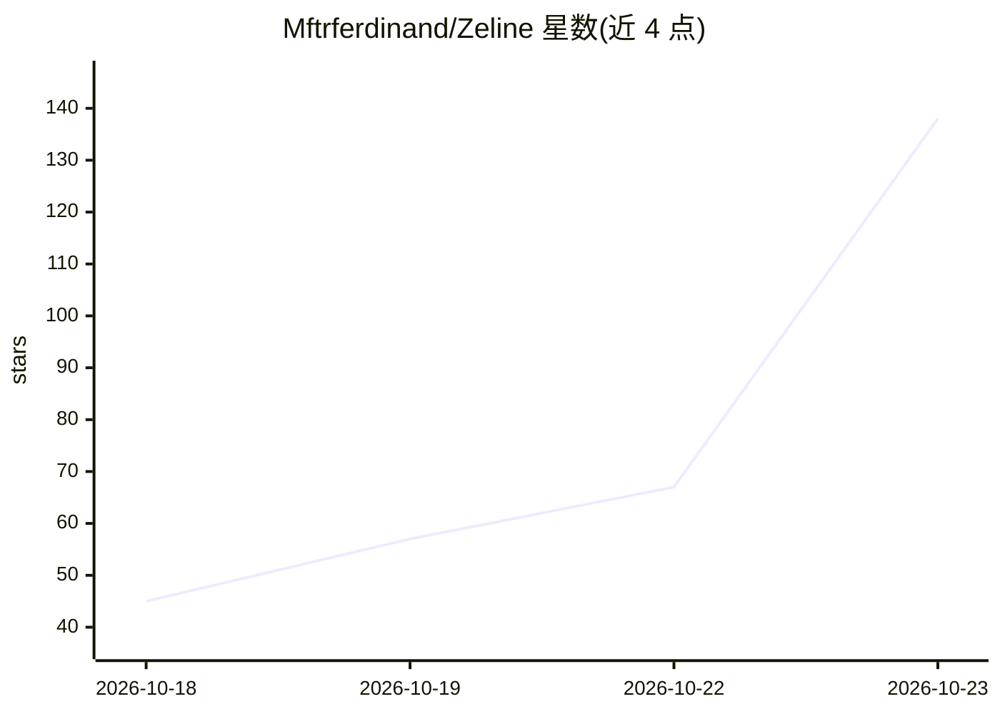

# Mftrferdinand/Zeline

⭐ 138 · Python · MIT · 推送 2026-10-22 · [GitHub](https://github.com/Mftrferdinand/Zeline) · [官网](https://github.com/Mftrferdinand/Zeline) · 组织维护

**模型无关的开源 agentic AI 框架，构建可接入消息平台的 agent**

由 Zerolinear 开发的 Python agentic 框架：提供 OpenAI 兼容的 agent 循环、工具调用、持久记忆（SQLite 会话）与子代理委托，模型与提供商（OpenAI/OpenRouter/vLLM/Ollama 及 OpenAI/Anthropic 兼容 API）可切换而不重建系统。内置网页搜索、浏览器控制（CDP 驱动 Chromium/Chrome）、代码执行、图像生成等工具，支持 MCP 客户端与 Python 插件钩子。通过 Telegram、WhatsApp（Baileys）或本地 HTTP webhook 网关交互，按 safe/workspace/full 三级工具档案控制权限。安装走 PyPI 或各平台一键脚本，要求 Python 3.10+（WhatsApp 另需 Node.js 18+）。

## 筛选速览

| 维度 | 判定 | 备注 |
|---|---|---|
| AI 角色 | `ai-ecosystem` | LLM/agent 周边工具 |
| 许可风险 | `permissive` | MIT |
| 部署形态 | `library` | 以包/库形式分发 |
| 模型依赖 | local-ok | 支持本地模型 |
| 硬件要求 | — | 无带数字的原话,不猜 |
| 安装摩擦 | `low` | 无编译、无系统依赖或容器化 |
| 成熟度 | — | 结构信号不足 |

## 能力要点

- 模型无关：OpenAI/OpenRouter/vLLM/Ollama 及兼容 API 可切换
- Telegram/WhatsApp/HTTP webhook 三种消息网关，会话存 SQLite
- CDP 直驱 Chromium/Chrome 的浏览器控制工具，无 Playwright 依赖
- safe/workspace/full 三级工具档案与 Python 插件审计钩子、MCP 客户端

## 适用场景

- 搭建接入 Telegram/WhatsApp 的自托管 AI 助手
- 构建可更换模型提供商的多步 agent 工作流
- 通过 webhook 与本地服务集成对话能力

## 场景标签

`Agent 框架` · 领域:Agent 开发

## 证据(README 行号)

> L7: Zeline is an open-source agentic AI framework developed by **Zerolinear**. It's a flexible foundation for building A
> L9: Rather than being tied to a single model, provider, or infrastructure, Zeline is built around flexibility. Connect y
> L16: - **Model-agnostic** — works with OpenAI, OpenRouter, vLLM, Ollama, and any OpenAI- or Anthropic-compatible API; sw

## 星数曲线

2026-10-18 45 → 2026-10-23 138（+93）

---
*卡片 v1 · prompt 1.4 · 生成 2026-10-23 · 置信度 high · 依据 README sha `71842cf62be7` · [字段定义](../../DATASET.md)*
