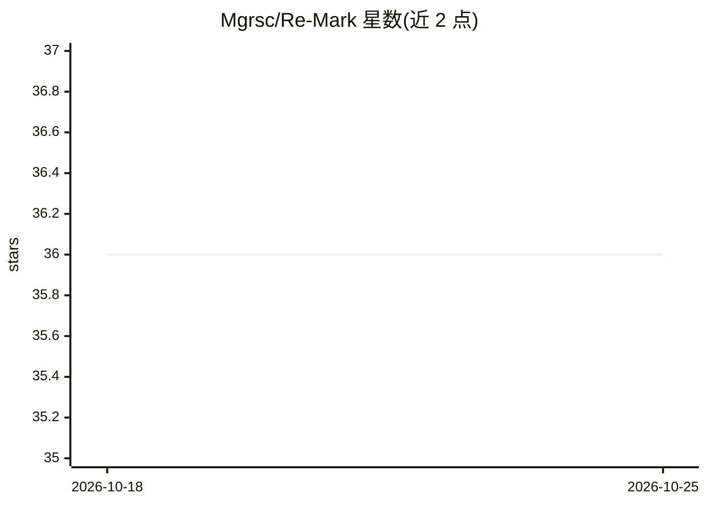

# Mgrsc/Re-Mark

⭐ 36 · TypeScript · 推送 2026-09-26 · [GitHub](https://github.com/Mgrsc/Re-Mark) · [官网](https://re-mark.vercel.app) · 个人维护 · 中文 README

**浏览器书签同步与 AI 富化工具，配 Web 端浏览**

以浏览器原生书签为核心的工具：浏览器扩展通过 GitHub Gist 在 Chrome/Firefox/Edge 间同步书签，改写本地书签标题以清理超长或营销文案；配置 AI API Key 与 Jina Key 后，可在扩展内调用 AI 与 Jina Auth Reader 为书签生成摘要、标签和封面，默认并发 10，遇 429 自动退避重试。Web 端仅负责浏览 Gist 中的书签数据，支持 Vercel 部署或本地 bun 运行，并提供 5 种主题。Token 与数据存储在用户自己的 Gist。

## 筛选速览

| 维度 | 判定 | 备注 |
|---|---|---|
| AI 角色 | `ai-enhanced` | 去掉 AI 部分产品仍成立 |
| 许可风险 | `none` | — |
| 部署形态 | `None` |  |
| 模型依赖 | — | README 未给出锁定关系 |
| 硬件要求 | — | 无带数字的原话,不猜 |
| 安装摩擦 | `low` | 无编译、无系统依赖或容器化 |
| 成熟度 | — | 结构信号不足 |

## 能力要点

- GitHub Gist 跨 Chrome/Firefox/Edge 同步书签
- 扩展内清理书签标题（去除超长/营销文案）
- AI + Jina Auth Reader 生成摘要、标签、封面，可调并发并自动退避重试
- Web 端提供 5 种主题与 Vercel/本地两种部署方式

## 适用场景

- 在多个浏览器间同步并统一管理书签
- 批量清理杂乱的书签标题
- 为书签自动生成摘要与标签便于检索浏览
- 自托管书签数据并随时通过网页查看

## 场景标签

`知识库管理` · 领域:知识与检索

## 证据(README 行号)

> L5: 一个基于原生浏览器书签的知识库：用 GitHub Gist 跨浏览器同步书签，在扩展内清理浏览器书签标题，并可用 AI 为书签生成摘要、标签和封面，Web 端只负责浏览展示。
> L12: - 🤖 **AI 智能富化** - 扩展内调用 AI 和 Jina Auth Reader 提取摘要、标签、封面，让书签更易管理和检索

## 星数曲线

2026-10-18 36 → 2026-10-25 36（+0）

---
*卡片 v1 · prompt 1.4 · 生成 2026-10-25 · 置信度 high · 依据 README sha `aad1b998dee5` · [字段定义](../../DATASET.md)*
