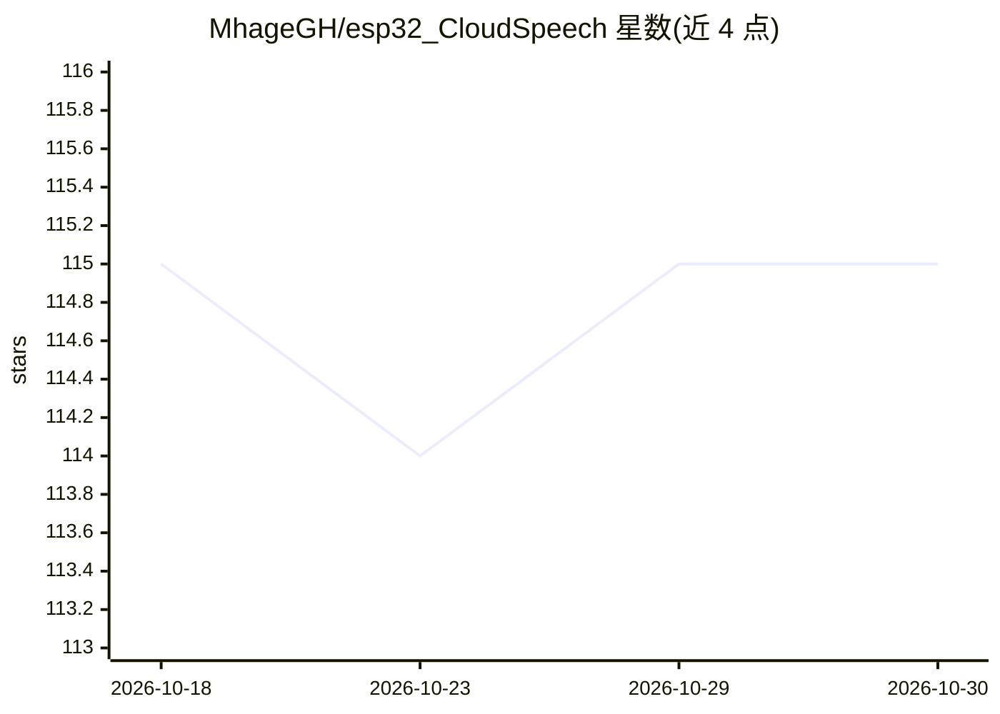

# MhageGH/esp32_CloudSpeech

⭐ 115 · C++ · MIT · 推送 2026-04-21 · [GitHub](https://github.com/MhageGH/esp32_CloudSpeech) · 个人维护

**ESP32 麦克风录音经 Google 语音转文字 API 输出转写**

在 ESP32 或 M5Stack FIRE/Core2 开发板上连接麦克风采集语音，调用 Google Cloud Speech-to-Text API 完成语音转文字，转写结果显示在串口监视器。开发环境为 Arduino IDE 与 arduino-esp32；用户需自行申请 Google Cloud 账号，并在 network_param.h 中配置网络与账号信息。支持 ICS43434、AE-ADMP441_K 等麦克风，M5Stack FIRE/Core2 自带 esp32 与麦克风，无需接线。

## 筛选速览

| 维度 | 判定 | 备注 |
|---|---|---|
| AI 角色 | `ai-native` | 本体是模型或模型工具 |
| 许可风险 | `permissive` | MIT |
| 部署形态 | `None` |  |
| 模型依赖 | — | README 未给出锁定关系 |
| 硬件要求 | — | 无带数字的原话,不猜 |
| 安装摩擦 | `low` | 无编译、无系统依赖或容器化 |
| 成熟度 | — | 结构信号不足 |

## 能力要点

- ESP32 采集语音并调用 Google Cloud Speech-to-Text 转写
- 支持 ESP32-DevKitC 外接麦克风与 M5Stack FIRE/Core2 一体化硬件
- 转写结果输出到串口监视器

## 适用场景

- 在嵌入式设备上做语音识别转写实验
- 用 M5Stack FIRE 免接线快速搭建语音转文字 demo
- 学习 ESP32 与云端语音 API 的对接

## 场景标签

`语音识别` · 领域:感知与多模态

## 证据(README 行号)

> L3: Transcribe your voice by Google's Cloud Speech-to-Text API with esp32
> L2: Let's try voice recognition by machine learning!

## 星数曲线

2026-10-18 115 → 2026-10-30 115（+0）

---
*卡片 v1 · prompt 1.4 · 生成 2026-10-23 · 置信度 high · 依据 README sha `3b50dfd37c6d` · [字段定义](../../DATASET.md)*
