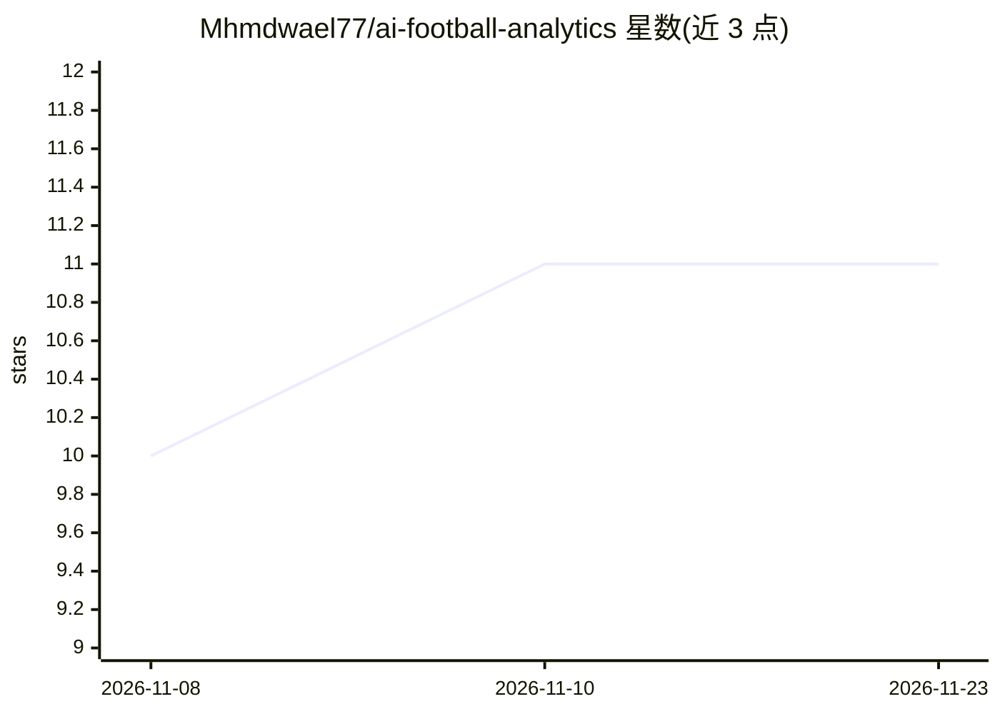

# Mhmdwael77/ai-football-analytics

⭐ 11 · Python · NOASSERTION · 推送 2026-09-20 · [GitHub](https://github.com/Mhmdwael77/ai-football-analytics) · 个人维护

**从比赛视频生成战术与球员表现报告的足球视觉分析系统**

处理足球比赛视频的端到端计算机视觉流水线，共 12 个阶段：YOLO11m 检测球员/门将/裁判/球四类目标，BoT-SORT 追踪并修复断裂/互换的 ID，从球衣颜色直方图聚类动态发现队伍与角色，自训练关键点模型逐帧求解单应性完成球场标定，进而计算速度、距离、热图、控球率、战术画像与 0-10 球员评分，最后输出自然语言比赛报告（不使用外部 LLM）。队伍、球衣颜色、球场几何与角色均按场次从画面学习，无逐视频硬编码；支持两处可选人工校正触点；340+ 测试可在无 GPU、无权重下运行。

## 筛选速览

| 维度 | 判定 | 备注 |
|---|---|---|
| AI 角色 | `ai-native` | 本体是模型或模型工具 |
| 许可风险 | `permissive` | NOASSERTION |
| 部署形态 | `library` | 以包/库形式分发 |
| 模型依赖 | — | README 未给出锁定关系 |
| 硬件要求 | — | 无带数字的原话,不猜 |
| 安装摩擦 | `medium` | 含编译或系统依赖之一 |
| 成熟度 | — | 结构信号不足 |

## 能力要点

- 自训练 YOLO11m 检测器覆盖球员、门将、裁判、球四类
- BoT-SORT 人员追踪 + 专用球追踪器，带外观拼接与 ID 互换修复
- 自训练关键点模型逐帧单应性标定，投影到真实球场米制坐标
- 每阶段输出 JSON 与 TXT 双格式，阶段间以类型化数据契约解耦

## 适用场景

- 分析整场比赛视频，生成球员评分与比赛报告
- 提取每队战术画像、控球时间线与站位热图
- 生成带骨架叠加、战术小地图与实时速度条的视频输出

## 场景标签

`图像视频处理` `目标检测` · 领域:感知与多模态

## 证据(README 行号)

> L20: video from raw frames all the way to an analyst-grade report. It detects and
> L24: per-player rating — finishing with a natural-language match report.
> L38: - 🎯 **Custom-trained YOLO11m detector** for 4 classes (player · goalkeeper · referee · ball).

## 星数曲线

2026-11-08 10 → 2026-11-23 11（+1）

---
*卡片 v1 · prompt 1.4 · 生成 2026-11-19 · 置信度 high · 依据 README sha `908abdd0f14a` · [字段定义](../../DATASET.md)*
