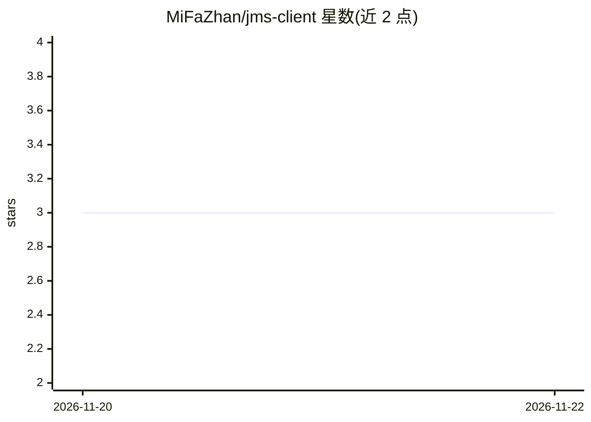

# MiFaZhan/jms-client

⭐ 3 · Go · MIT · 推送 2026-11-10 · [GitHub](https://github.com/MiFaZhan/jms-client) · 个人维护 · 中文 README

**JumpServer v4 堡垒机的 CLI 客户端与 MCP 服务器**

用 Go 编写的 JumpServer v4 命令行客户端与 MCP 服务器：通过 Core REST API 与 KoKo 终端网关访问堡垒机后端资产，提供连接池复用、内外网地址探测与故障切换、SFTP 上传下载、交互式登录、本地 JSONL 审计日志等能力。`jms mcp` 以 stdio 运行 Model Context Protocol 服务器，注册 29 个默认工具供 MCP 客户端列出资产、执行命令和传输文件；写入类与调试类工具默认关闭，需环境变量显式开启。仅支持 JumpServer v4，单平台二进制不含 32 位构建。

## 筛选速览

| 维度 | 判定 | 备注 |
|---|---|---|
| AI 角色 | `ai-enhanced` | 去掉 AI 部分产品仍成立 |
| 许可风险 | `permissive` | MIT |
| 部署形态 | `desktop` | 安装包/桌面程序 |
| 模型依赖 | — | README 未给出锁定关系 |
| 硬件要求 | — | 无带数字的原话,不猜 |
| 安装摩擦 | `low` | 无编译、无系统依赖或容器化 |
| 成熟度 | — | 结构信号不足 |

## 能力要点

- 连接池与会话复用，一次登录服务多条命令
- 内外网双地址探测与端点故障切换
- MCP 服务器提供 29 个默认工具，写入工具需显式开启
- 凭据存于 OS 凭据库，全部操作写本地审计日志

## 适用场景

- 在 shell 管道与 CI 任务中直连堡垒机背后的资产执行命令
- 让 Claude Desktop、Cursor 等 MCP 客户端通过同一连接池操作堡垒机
- 通过 CLI 创建资产并一步完成权限授予
- 用 SFTP 子命令上传下载堡垒机后端文件

## 场景标签

 · 领域:运维/DevOps 工具

## 证据(README 行号)

> L7: **A command-line client and MCP server for JumpServer v4 bastion hosts.**
> L24: - **Everything is logged locally, and an AI assistant can drive the same pool.** `jms mcp` speaks the Model Context

## 星数曲线

2026-11-20 3 → 2026-11-22 3（+0）

---
*卡片 v1 · prompt 1.4 · 生成 2026-11-22 · 置信度 high · 依据 README sha `d610f2003c89` · [字段定义](../../DATASET.md)*
