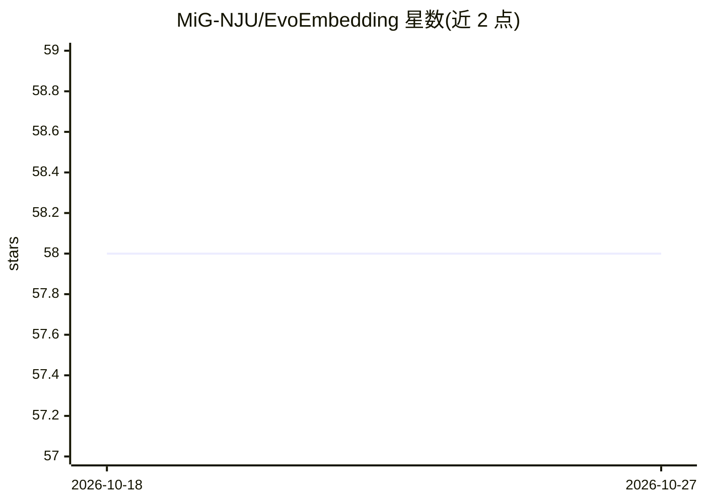

# MiG-NJU/EvoEmbedding

⭐ 58 · Python · Apache-2.0 · 推送 2026-07-24 · [GitHub](https://github.com/MiG-NJU/EvoEmbedding) · [官网](https://MIG-NJU.github.io/EvoEmbedding/) · 组织维护

**可演化嵌入模型：为长上下文检索与Agent记忆生成上下文感知表示**

由南京大学 MiG 团队发布的嵌入模型与训练框架：顺序处理输入流，持续更新有界 FIFO Latent Memory Queue，并与原始内容结合生成对时间顺序与语义变化敏感的可演化嵌入。提供 0.8B/2B/4B 三个规模的模型与 EvoTrain-180K 训练数据，支持作为嵌入模型和重排序器使用，并提供 SFT 训练与基准评测脚本；训练基于 Qwen3 基座模型，通过 conda 环境与 pip 依赖文件运行。

## 筛选速览

| 维度 | 判定 | 备注 |
|---|---|---|
| AI 角色 | `ai-native` | 本体是模型或模型工具 |
| 许可风险 | `permissive` | Apache-2.0 |
| 部署形态 | `library` | 以包/库形式分发 |
| 模型依赖 | — | README 未给出锁定关系 |
| 硬件要求 | — | 无带数字的原话,不猜 |
| 安装摩擦 | `low` | 无编译、无系统依赖或容器化 |
| 成熟度 | — | 结构信号不足 |

## 能力要点

- Latent Memory Queue + 可演化嵌入生成，对时间顺序与语义变化敏感
- 发布 EvoTrain-180K 数据集（chat 式 SFT+检索联合优化格式）
- 可作为嵌入模型或重排序器使用，兼容现有 Agent 记忆框架（A-MEM、LightMem）
- 提供 0.8B/2B/4B 三规模训练与评测脚本

## 适用场景

- 长对话历史或多轮会话场景下的检索与问答
- Agent 记忆系统的嵌入层替换为即插即用组件
- 按自有文档/客服日志数据微调领域检索模型

## 场景标签

`Agent 记忆` `RAG` `微调` · 领域:Agent 开发

## 证据(README 行号)

> L18: Instead of encoding text segments into isolated static vectors, EvoEmbedding sequentially processes the input strea
> L26: Existing embedding models are inherently static: they encode text segments in isolation, ignoring their surrounding

## 星数曲线

2026-10-18 58 → 2026-10-27 58（+0）

---
*卡片 v1 · prompt 1.4 · 生成 2026-10-24 · 置信度 mid · 依据 README sha `ae90fe7ef5ee` · [字段定义](../../DATASET.md)*
