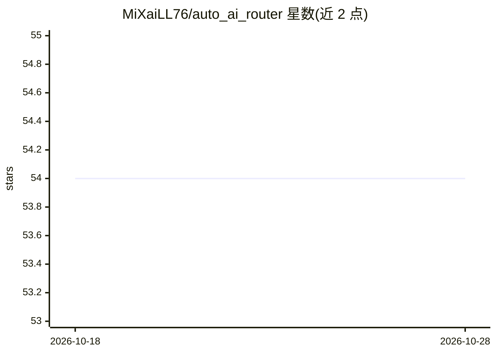

# MiXaiLL76/auto_ai_router

⭐ 54 · Go · Apache-2.0 · 推送 2026-10-26 · [GitHub](https://github.com/MiXaiLL76/auto_ai_router) · [官网](https://mixaill76.github.io/auto_ai_router/) · 个人维护

**面向多 LLM API 的高性能代理路由与负载均衡网关**

用 Go 编写的 LLM API 代理路由器：将请求路由到 OpenAI、Vertex AI、Gemini AI Studio、Anthropic、Comet API 及其他 Auto AI Router 实例。机制包括按模型的多凭据轮询负载均衡、按凭据/模型的 RPM/TPM 速率限制、重复出错自动封禁（fail2ban）、Prometheus 指标、LiteLLM 数据库集成（消费日志与 API key 认证）、全 SSE 流式支持与环境变量凭据管理。以源码构建或 Docker 镜像方式部署，文档托管于 GitHub Pages，Apache 2.0 许可。

## 筛选速览

| 维度 | 判定 | 备注 |
|---|---|---|
| AI 角色 | `ai-ecosystem` | LLM/agent 周边工具 |
| 许可风险 | `permissive` | Apache-2.0 |
| 部署形态 | `self-host` | docker 或自建部署 |
| 模型依赖 | — | README 未给出锁定关系 |
| 硬件要求 | — | 无带数字的原话,不猜 |
| 安装摩擦 | `low` | 无编译、无系统依赖或容器化 |
| 成熟度 | — | 结构信号不足 |

## 能力要点

- 多提供商路由：OpenAI、Vertex AI、Gemini、Anthropic、Comet API、代理链
- 按凭据轮询负载均衡与 RPM/TPM 速率限制
- fail2ban 式重复出错自动封禁提供商
- Prometheus 指标与 LiteLLM DB 消费日志/key 认证集成

## 适用场景

- 为多个 LLM 提供商凭据做统一接入与负载均衡
- 在凭据额度或故障之间自动切换与封禁
- 团队统一计量 LLM 消费并按 API key 认证

## 场景标签

`模型网关` · 领域:Agent 开发

## 证据(README 行号)

> L8: High-performance proxy router for LLM APIs with automatic load balancing, rate limiting, and fail2ban protection. Ro
> L12: - **Multi-provider support** — OpenAI, Vertex AI, Gemini, Anthropic, Comet API, Proxy chains

## 星数曲线

2026-10-18 54 → 2026-10-28 54（+0）

---
*卡片 v1 · prompt 1.4 · 生成 2026-10-24 · 置信度 high · 依据 README sha `a59b38ef407b` · [字段定义](../../DATASET.md)*
