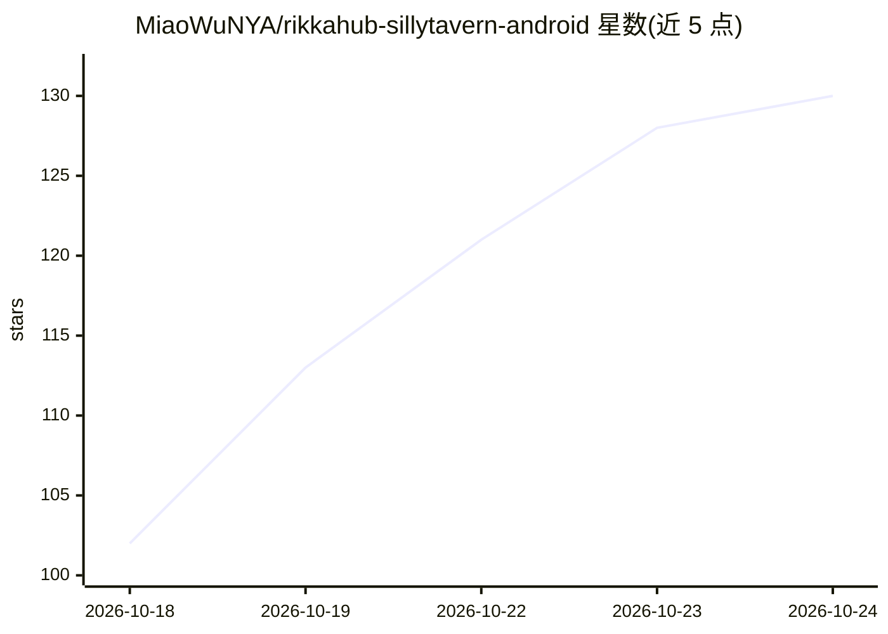

# MiaoWuNYA/rikkahub-sillytavern-android

⭐ 134 · Kotlin · AGPL-3.0 · 推送 2026-10-22 · [GitHub](https://github.com/MiaoWuNYA/rikkahub-sillytavern-android) · [官网](https://rikkahub.luoca.cn) · 个人维护 · 中文 README

**安卓 AI 聊天客户端，深度兼容 SillyTavern 卡片与预设**

基于 RikkaHub 的深度定制分支（Kotlin + Jetpack Compose），可作为通用多供应商 AI 聊天应用，也可作为 SillyTavern 兼容端使用：角色卡/世界书/预设/正则按官方语义无损导入。核心机制包括前缀缓存优化（消除逐轮上下文分歧点，含前缀分歧诊断视图）、三层记忆与语义 RAG、Jev 判定小模型（只判定不生成，失败时静默回退）、QuickJS 沙箱插件系统（SHA-256 校验、Zip-Slip 防护）。提供 APK 发布（arm64-v8a，Android 8.0+），支持中国大陆镜像自动回退更新。

## 筛选速览

| 维度 | 判定 | 备注 |
|---|---|---|
| AI 角色 | `ai-native` | 本体是模型或模型工具 |
| 许可风险 | `viral` | AGPL-3.0 |
| 部署形态 | `None` |  |
| 模型依赖 | — | README 未给出锁定关系 |
| 硬件要求 | — | 无带数字的原话,不猜 |
| 安装摩擦 | `low` | 无编译、无系统依赖或容器化 |
| 成熟度 | — | 结构信号不足 |

## 能力要点

- 前缀缓存优化：冻结锚点、确定性宏解析、前缀分歧诊断视图
- SillyTavern 卡片/世界书/预设/正则/主题按官方语义无损导入
- Jev 判定模型做记忆筛选与 judge 工具，失败静默回退
- QuickJS 沙箱插件系统，含完整性校验与网络安全边界

## 适用场景

- 安卓手机上直接与各供应商 API 模型聊天
- 从桌面 SillyTavern 迁移角色卡与世界书到移动端
- 通过长对话缓存命中降低 token 费用
- 用插件扩展 AI 可调用工具与页面卡片

## 场景标签

`聊天机器人` · 领域:对话与助手

## 证据(README 行号)

> L5: ### An **AI chat client** for Android that is also a **SillyTavern**-compatible endpoint
> L18: > - **Just want a good AI chat app**: plug in any API and start talking — multi-provider, streaming, voice calls, p

## 星数曲线

2026-10-18 102 → 2026-10-24 130（+28）

---
*卡片 v1 · prompt 1.4 · 生成 2026-10-23 · 置信度 high · 依据 README sha `1feb0f759ed7` · [字段定义](../../DATASET.md)*
