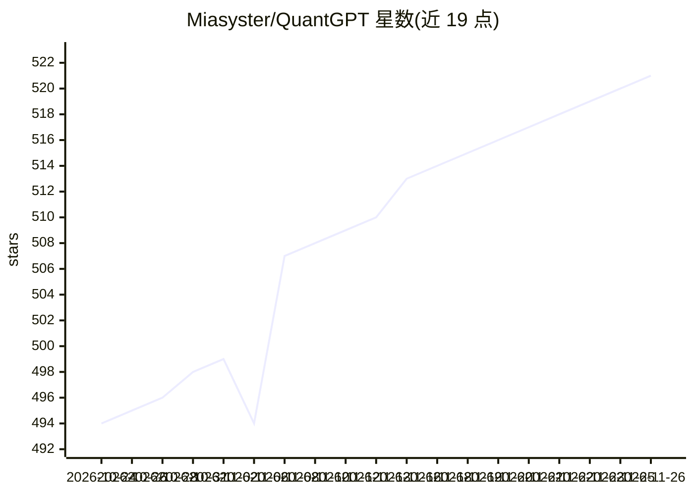

# Miasyster/QuantGPT

⭐ 521 · Python · MIT · 推送 2026-11-23 · [GitHub](https://github.com/Miasyster/QuantGPT) · 个人维护 · 中文 README

**LLM Agent 自治挖掘、回测并验证 A 股 alpha 因子的研究引擎**

提供 15 个 MCP 工具的因子研究引擎，让 Claude 等 LLM Agent 自治完成因子挖掘、批量回测、多维评分、反过拟合检验与 Walk-forward 验证；核心机制包括双 LLM 交叉评审（DeepSeek Reasoner 复核结论）、跨会话持久知识库（规则/发现/失败三目录）、并发批量评估与三阶段进化迭代。默认 SQLite 与 baostock/akshare 免费数据源，零配置运行；仅支持 A 股日线频率，WQ BRAIN 提交为可选功能。

## 筛选速览

| 维度 | 判定 | 备注 |
|---|---|---|
| AI 角色 | `ai-native` | 本体是模型或模型工具 |
| 许可风险 | `permissive` | MIT |
| 部署形态 | `library` | 以包/库形式分发 |
| 模型依赖 | locked-api |  |
| 硬件要求 | — | 无带数字的原话,不猜 |
| 安装摩擦 | `low` | 无编译、无系统依赖或容器化 |
| 成熟度 | — | 结构信号不足 |

## 能力要点

- 15 个 MCP 工具供 Claude Code/Claude Desktop 驱动自治研究循环
- 自研表达式解析器含 60+ 算子，区分 local 与 wq 两种模式
- 三层反过拟合体系：统计检验 + Walk-forward + WQ 模拟
- 双 LLM 交叉评审与跨会话结构化知识库

## 适用场景

- 在沪深300上让 Agent 自动迭代挖掘高质量因子
- 提交前对因子做反过拟合与样本外验证
- 通过 REST API 把因子回测接入外部系统或 CI

## 场景标签

`金融量化` · 领域:学习与行业

## 证据(README 行号)

> L29: QuantGPT is an **agent-driven factor research engine** — not a backtest library, not a chatbot wrapper. It gives an
> L204: |**MCP (primary)**|Agent toolkit|Claude Code / Claude Desktop 通过 MCP 调用所有研究工具，驱动自治研究循环|

## 星数曲线

2026-10-24 494 → 2026-11-26 521（+27）

---
*卡片 v1 · prompt 1.4 · 生成 2026-11-25 · 置信度 mid · 依据 README sha `17a44c9250fd` · [字段定义](../../DATASET.md)*
