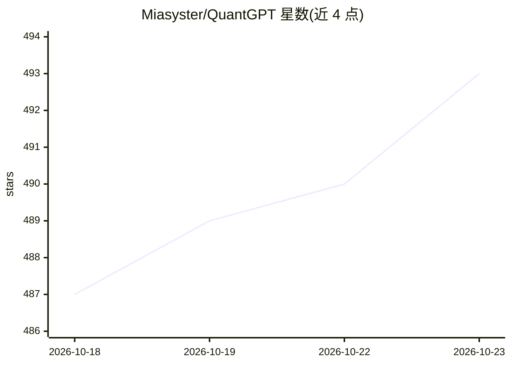

# Miasyster/QuantGPT

⭐ 493 · Python · MIT · 推送 2026-05-20 · [GitHub](https://github.com/Miasyster/QuantGPT) · 个人维护 · 中文 README

**给量化研究者的 Agent 驱动因子挖掘引擎，自动回测并提交 WorldQuant BRAIN**

因子研究引擎：向 LLM Agent（Claude Code/Desktop，经 MCP 提供 15 个工具）提供完整工具箱，由 Agent 自主设计、批量回测、多维评分与迭代 alpha 因子；含双 LLM 交叉评审（DeepSeek）、跨会话结构化知识库、四层反过拟合验证与滚动验证。A 级因子自动上传 QuantGPT Cloud 做独立 IC/IR 验证，可选直连 WQ BRAIN 提交。后端 Python/FastAPI + SQLite，数据来自 baostock/akshare；限制为仅 A 股、仅日频。也可无 LLM 直接以表达式经 REST API 回测。

## 筛选速览

| 维度 | 判定 | 备注 |
|---|---|---|
| AI 角色 | `ai-ecosystem` | LLM/agent 周边工具 |
| 许可风险 | `permissive` | MIT |
| 部署形态 | `library` | 以包/库形式分发 |
| 模型依赖 | locked-api |  |
| 硬件要求 | — | 无带数字的原话,不猜 |
| 安装摩擦 | `low` | 无编译、无系统依赖或容器化 |
| 成熟度 | — | 结构信号不足 |

## 能力要点

- MCP 提供 15 个研究工具，Agent 自治完成挖掘-回测-迭代闭环
- 自研表达式解析器：60+ 算子，含 WQ BRAIN 兼容模式
- 双 LLM 交叉评审 + 跨会话知识库（规则/发现/失败）
- 反过拟合四层：统计检验、walk-forward、Cloud 独立验证、WQ 模拟

## 适用场景

- 让 Claude Agent 在沪深300 等股票池上自治挖掘并迭代因子
- 批量并发回测因子表达式并按 fitness 排序
- 将 A 级因子提交 QuantGPT Cloud 独立验证或 WQ BRAIN
- 无 LLM 场景下直接调用 REST API 做表达式回测

## 场景标签

`金融量化` `Agent 框架` · 领域:Agent 开发

## 证据(README 行号)

> L29: QuantGPT is an **agent-driven factor research engine** — not a backtest library, not a chatbot wrapper. It gives an
> L207: |**MCP (primary)**|Agent toolkit|Claude Code / Claude Desktop 通过 MCP 调用所有研究工具，驱动自治研究循环|

## 星数曲线

2026-10-18 487 → 2026-10-23 493（+6）

---
*卡片 v1 · prompt 1.4 · 生成 2026-10-21 · 置信度 mid · 依据 README sha `c4a16685886f` · [字段定义](../../DATASET.md)*
