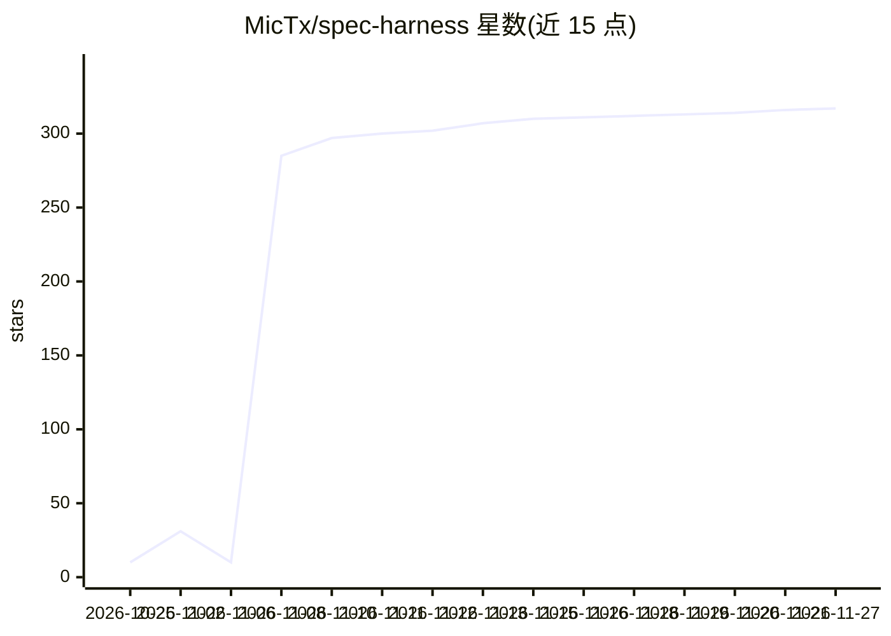

# MicTx/spec-harness

⭐ 317 · Python · NOASSERTION · 推送 2026-11-26 · [GitHub](https://github.com/MicTx/spec-harness) · 个人维护 · 中文 README

**为 AI 编程智能体提供任务包工作流与 Git 门禁的 CLI 工具**

以两相任务包工作流组织 AI 编程智能体的长期改动：规划期用宪章与机器 lint 写出可判定字段并经 plan-go 授权，执行期按任务 DAG 自动推进、验证和检查点提交，check 循环补跑验证并按证据修复。任务包由 spec.md/tasks.md/runs.jsonl/state.json 构成，交付需通过证据门禁，Git 推送须用户显式授权。通过安装脚本部署到多个 agent 宿主的会话 hook，提供 /spec 系列命令与 update 更新器。

## 筛选速览

| 维度 | 判定 | 备注 |
|---|---|---|
| AI 角色 | `ai-ecosystem` | LLM/agent 周边工具 |
| 许可风险 | `none` | NOASSERTION |
| 部署形态 | `None` |  |
| 模型依赖 | — | README 未给出锁定关系 |
| 硬件要求 | — | 无带数字的原话,不猜 |
| 安装摩擦 | `low` | 无编译、无系统依赖或容器化 |
| 成熟度 | — | 结构信号不足 |

## 能力要点

- spec.md/tasks.md 任务包 + runs.jsonl/state.json 证据台账
- 支持 10+ agent 宿主（Claude Code、Codex、Gemini、Cursor、Devin 等）
- Git 门禁：push 需显式授权，命令不改写提交历史
- update 命令支持版本检查、dry-run 与国内镜像源

## 适用场景

- 让 AI 编程智能体按规格化任务包执行长期改动
- 在 AI 改动交付前强制通过可核对的验证门禁
- 多宿主环境下统一安装与更新 agent 工作流

## 场景标签

`工作流自动化` `编码 Agent` · 领域:效率与自动化

## 证据(README 行号)

> L3: 面向 AI 编程智能体的两相任务包工作流：规划期做厚，执行期不问用户，直到可核对地交付。
> L9: 一个包只包含 `.spec/specs/YYYY-MM-DD_slug/` 下的 `spec.md` 与 `tasks.md`；`runs.jsonl` 和 `state.json` 由 harness 写入。规划期用宪章与机器 l
> L27: |Claude Code / Desktop|`claude` / `claude-desktop`|

## 星数曲线

2026-10-25 10 → 2026-11-27 317（+307）

---
*卡片 v1 · prompt 1.4 · 生成 2026-11-26 · 置信度 mid · 依据 README sha `6502c71e2fb3` · [字段定义](../../DATASET.md)*
