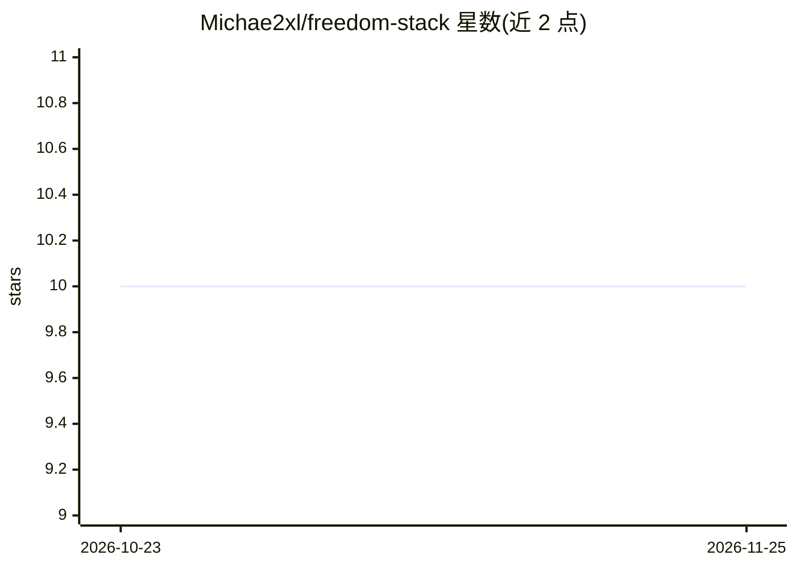

# Michae2xl/freedom-stack

⭐ 10 · Shell · NOASSERTION · 推送 2026-03-18 · [GitHub](https://github.com/Michae2xl/freedom-stack) · 个人维护

**自托管 AI Agent 隐私云：一键部署约18个隐私容器**

面向 VPS 的 Docker Compose 自托管栈，为 AI Agent 提供隐私导向的基础设施：Ollama 本地 LLM 推理、n8n 工作流编排、Qdrant 向量存储、隔离沙箱、SearXNG 匿名搜索，并通过 Tor 轮换电路与 .onion 隐藏服务路由流量。附带 Prometheus/Grafana 等监控容器与 UFW/fail2ban/CrowdSec 加固。提供单条 install.sh 命令部署，要求 Ubuntu 22.04/24.04 VPS，也可在 Mac 上运行。

## 筛选速览

| 维度 | 判定 | 备注 |
|---|---|---|
| AI 角色 | `ai-ecosystem` | LLM/agent 周边工具 |
| 许可风险 | `none` | NOASSERTION |
| 部署形态 | `None` |  |
| 模型依赖 | local-ok | 支持本地模型 |
| 硬件要求 | `cpu-ok` | |
| 安装摩擦 | `low` | 无编译、无系统依赖或容器化 |
| 成熟度 | `idea` | |

## 能力要点

- 一条 install.sh 命令部署约18个容器
- Ollama 本地推理 + Qdrant 向量记忆 + n8n 工作流
- Tor 轮换电路（每30秒）与 .onion 隐藏服务
- UFW/fail2ban/CrowdSec/AppArmor 等安全加固

## 适用场景

- 在自有 VPS 上运行不外泄数据的 Agent 基础设施
- 为爬虫与 API 调用提供 Tor 匿名网络路由
- 自托管搜索、通知与向量存储等服务

## 场景标签

`网页抓取` `工作流自动化` · 领域:效率与自动化

## 证据(README 行号)

> L5: **Privacy infrastructure for AI agents.**
> L57:  Agent Privacy Cloud (9 containers)
> L62: |**n8n**|Visual workflow orchestration for agents|`http://n8n:5678/api/v1`|

## 星数曲线

2026-10-23 10 → 2026-11-25 10（+0）

---
*卡片 v1 · prompt 1.4 · 生成 2026-11-20 · 置信度 high · 依据 README sha `e3c22507dfbd` · [字段定义](../../DATASET.md)*
