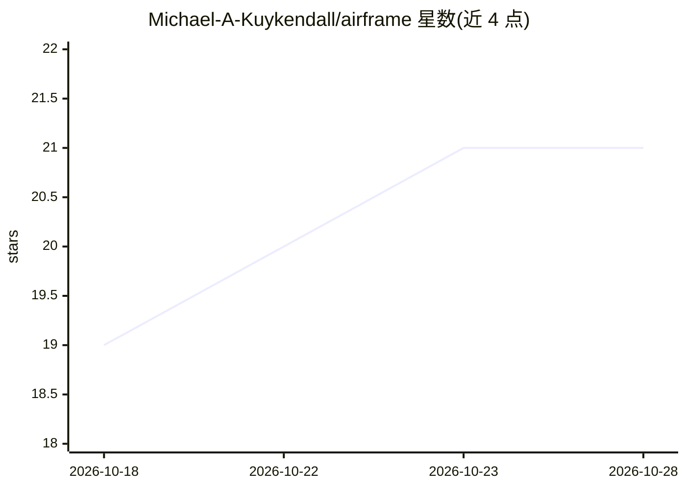

# Michael-A-Kuykendall/airframe

⭐ 21 · Rust · 推送 2026-10-19 · [GitHub](https://github.com/Michael-A-Kuykendall/airframe) · [官网](https://crates.io/crates/airframe) · 个人维护

**纯 Rust WebGPU 推理引擎：在多厂商 GPU 上运行 GGUF 模型**

以 Rust 与 WGSL compute shader 实现的 GGUF 模型 GPU 推理引擎，不依赖 C++ 工具链、Python 或 llama.cpp，在 NVIDIA、AMD、Intel 集成显卡与 Apple Silicon 上运行。支持 Llama、Mistral、Phi、Qwen、Gemma 等 12 族架构与 F32/Q4_0/Q6_K 等量化格式，宣称同配置下输出确定性可复现。附带 TurboShimmy INT4 KV 缓存压缩、FSE 语义规则引擎（声明有美国专利申请中）。作为 crate 发布，同时为 Shimmy 服务器提供推理核心。限制：认证覆盖以 8B 以下模型为主，超大模型可能超出显存。

## 筛选速览

| 维度 | 判定 | 备注 |
|---|---|---|
| AI 角色 | `ai-ecosystem` | LLM/agent 周边工具 |
| 许可风险 | `permissive` | — |
| 部署形态 | `library` | 以包/库形式分发 |
| 模型依赖 | — | README 未给出锁定关系 |
| 硬件要求 | — | 无带数字的原话,不猜 |
| 安装摩擦 | `medium` | 含编译或系统依赖之一 |
| 成熟度 | — | 结构信号不足 |

## 能力要点

- 纯 Rust/WGSL 实现，无 C++ 工具链与 llama.cpp 依赖，跨 NVIDIA/AMD/Intel/Apple Silicon
- 支持 12 族架构（Llama/Qwen3/Phi/Gemma 等）与 8 种量化格式，附认证流水线
- TurboShimmy INT4 KV 缓存压缩，声明约 7 倍 KV 显存缩减
- 同模型/种子/参数下输出确定性可复现

## 适用场景

- 在消费级 GPU 上本地运行 GGUF 量化模型推理
- 作为 Rust 项目依赖嵌入，构建可交叉编译的推理应用
- 需要可复现输出的评估流水线
- 显存受限设备上以 INT4 KV 缓存运行较长上下文

## 场景标签

`推理引擎` · 领域:训练与推理

## 证据(README 行号)

> L16: Airframe is the GPU inference core powering Shimmy. It runs full transformer inference directly on the GPU via WGSL
> L29: Most Rust LLM inference libraries are thin wrappers around llama.cpp — they require a C++ toolchain, link against n
> L49: See `examples/` for tokenizer and GPU probe examples, and the full inference path in the Shimmy server.

## 星数曲线

2026-10-18 19 → 2026-10-28 21（+2）

---
*卡片 v1 · prompt 1.4 · 生成 2026-10-28 · 置信度 high · 依据 README sha `e8679c916648` · [字段定义](../../DATASET.md)*
