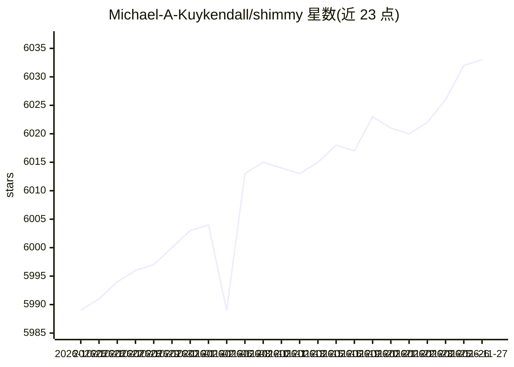

# Michael-A-Kuykendall/shimmy

⭐ 6,033 · Rust · Apache-2.0 · 推送 2026-11-12 · [GitHub](https://github.com/Michael-A-Kuykendall/shimmy) · 个人维护

**Rust 编写的本地 GGUF 推理服务器，OpenAI API 兼容**

Shimmy 是本地 GGUF 推理服务器与 CLI，用 Rust 实现、单一二进制分发，提供 OpenAI 兼容端点（模型列表、JSON chat/text 补全、chat-only SSE 流式）。回环访问无需密钥，非回环绑定需 SHIMMY_API_KEY 与来源白名单。支持模型懒加载与可选预热。正确性以固定 fixture 矩阵认证：已通过 Apple M1 虚拟 Metal 198/198 全 logits 比较；物理 M4、Qwen3.5 等平台/模型标记 NOT_RUN 或不支持；Gemma2、MoE、MLA、多模态执行器未启用。

## 筛选速览

| 维度 | 判定 | 备注 |
|---|---|---|
| AI 角色 | `ai-ecosystem` | LLM/agent 周边工具 |
| 许可风险 | `permissive` | Apache-2.0 |
| 部署形态 | `library` | 以包/库形式分发 |
| 模型依赖 | — | README 未给出锁定关系 |
| 硬件要求 | — | 无带数字的原话,不猜 |
| 安装摩擦 | `low` | 无编译、无系统依赖或容器化 |
| 成熟度 | — | 结构信号不足 |

## 能力要点

- OpenAI 兼容 API：模型列表、JSON chat/text 补全、chat-only SSE
- 本地 GGUF 推理，Rust 单二进制，无 Python 依赖
- 认证矩阵：FP32 全 logits 比较，覆盖指定 Qwen3/Llama 3.2 Q4_K_M fixture
- 回环免密钥，远程绑定需 API key 与来源白名单

## 适用场景

- 在本地 GPU 上运行 GGUF 模型并通过 OpenAI 兼容 API 调用
- 替代需要 Python 环境的本地推理部署方式
- 受限网络环境下以 API key 与来源控制暴露推理服务

## 场景标签

`推理引擎` · 领域:训练与推理

## 证据(README 行号)

> L24: Shimmy is a local GGUF inference server and CLI. The previous **Shimmy 2.6.6 / Airframe 0.4.5** release remains ava
> L64: Selected OpenAI-compatible endpoints provide model listing, JSON chat/text

## 星数曲线

2026-10-25 5,989 → 2026-11-27 6,033（+44）

---
*卡片 v1 · prompt 1.4 · 生成 2026-11-22 · 置信度 mid · 依据 README sha `bed897571479` · [字段定义](../../DATASET.md)*
