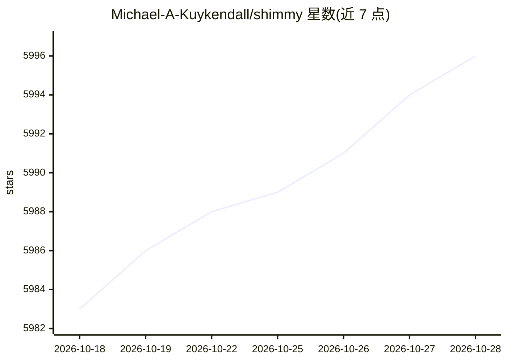

# Michael-A-Kuykendall/shimmy

⭐ 5,997 · Rust · Apache-2.0 · 推送 2026-10-19 · [GitHub](https://github.com/Michael-A-Kuykendall/shimmy) · 个人维护 · 中文 README

**纯 Rust 单二进制本地 GGUF 推理服务器，OpenAI API 兼容**

Shimmy 是单二进制的 OpenAI 兼容本地推理服务器，加载 GGUF 模型，底层运行纯 Rust WebGPU (WGSL) 引擎 Airframe，无 Python 与 C++ 工具链。支持 12 个模型家族、26 个经认证的模型/量化组合，提供 chat completions、文本补全与流式端点，兼容 OpenAI SDK。特性包括 INT4 KV cache 压缩、YaRN RoPE 扩展上下文、F32 累加精度下确定性输出。通过 cargo install 安装，MIT 许可，声明永久免费；v2.0+ 移除了 llama.cpp/MLX 等后端，SafeTensors 完整推理仍在路线图。

## 筛选速览

| 维度 | 判定 | 备注 |
|---|---|---|
| AI 角色 | `ai-ecosystem` | LLM/agent 周边工具 |
| 许可风险 | `permissive` | Apache-2.0 |
| 部署形态 | `library` | 以包/库形式分发 |
| 模型依赖 | — | README 未给出锁定关系 |
| 硬件要求 | — | 无带数字的原话,不猜 |
| 安装摩擦 | `low` | 无编译、无系统依赖或容器化 |
| 成熟度 | — | 结构信号不足 |

## 能力要点

- 单二进制纯 Rust 实现，WebGPU 覆盖 NVIDIA/AMD/Intel/Apple Silicon
- 12 模型家族、26 个认证模型/量化组合，3-box 认证流程
- INT4 KV cache 降低约 7× KV 缓存内存，可在 4GB GPU 运行 3B 模型
- OpenAI SDK 兼容：chat/text completions、流式与模型端点

## 适用场景

- 把现有 OpenAI SDK 工具指向本地端点做私有推理
- 在低显存 GPU 上运行量化 GGUF 模型
- 需要确定性输出（同模型+种子+参数→同结果）的本地推理场景

## 场景标签

`推理引擎` · 领域:训练与推理

## 证据(README 行号)

> L26: Shimmy is a **single-binary** OpenAI-compatible inference server for GGUF models. Point your existing AI tools at S
> L28: **Shimmy is the server. Airframe is the engine.** Under the hood, Shimmy runs on **Airframe** (v0.4.4), a pure-Rust
> L72: - **🚀 OpenAI SDK Compatibility** — Chat completions, text completions, streaming, and model endpoints. Works with O

## 星数曲线

2026-10-18 5,983 → 2026-10-28 5,996（+13）

---
*卡片 v1 · prompt 1.4 · 生成 2026-10-20 · 置信度 high · 依据 README sha `8ab8510f857d` · [字段定义](../../DATASET.md)*
