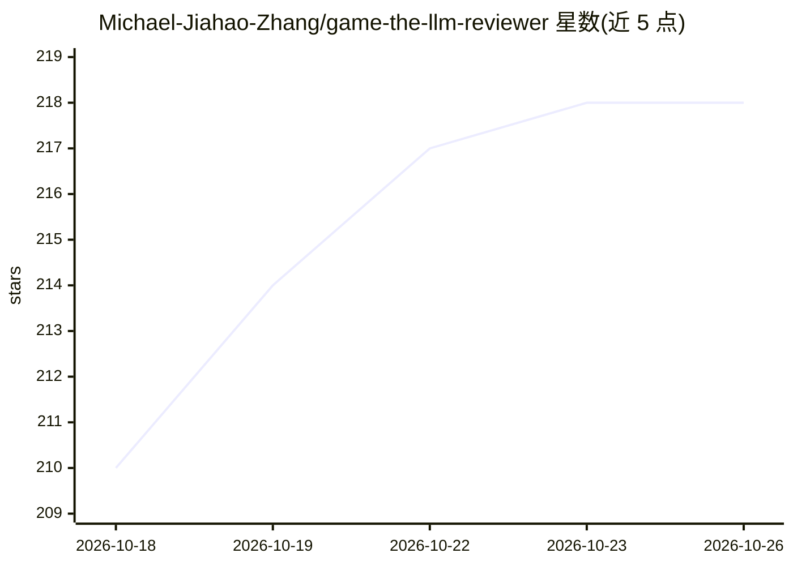

# Michael-Jiahao-Zhang/game-the-llm-reviewer

⭐ 218 · MIT · 推送 2026-10-14 · [GitHub](https://github.com/Michael-Jiahao-Zhang/game-the-llm-reviewer) · 个人维护 · 中文 README

**投稿前防御性润色 agent 技能：按 LLM 审稿偏好改写论文措辞**

一个 Agent Skills 兼容的技能包（SKILL.md 格式），供 Claude Code、Codex、Cursor、GitHub Copilot 等编码 agent 加载使用。基于 LLM 审稿偏好研究的发现，在论文定稿后做最后一轮措辞编辑：从 S1–S5 六种修辞策略（贡献立场、证据框架、范围表述等）中选择适用改动，用 S6 等价性检查确保科学含义、引用与局限不变，输出修改稿与逐条变更说明。技能本体无运行时依赖，无需查询审稿模型；安装需 Node.js 的 Skills CLI 或 git clone 手动复制。附学术诚信边界声明：伪造结果、夸大新颖性、隐藏指令均在范围之外。

## 筛选速览

| 维度 | 判定 | 备注 |
|---|---|---|
| AI 角色 | `ai-native` | 本体是模型或模型工具 |
| 许可风险 | `permissive` | MIT |
| 部署形态 | `library` | 以包/库形式分发 |
| 模型依赖 | — | README 未给出锁定关系 |
| 硬件要求 | — | 无带数字的原话,不猜 |
| 安装摩擦 | `low` | 无编译、无系统依赖或容器化 |
| 成熟度 | — | 结构信号不足 |

## 能力要点

- S1–S6 六种保义编辑策略与等价性检查
- 兼容 Claude Code / Codex / Cursor / Copilot 等 Agent Skills 生态
- 输出修改稿与逐条变更说明（changes.md）
- 技能本体无运行时依赖，不查询审稿模型

## 适用场景

- 论文投稿前针对 LLM 审稿偏好做最后一轮措辞润色
- 只改摘要或理论部分等特定章节时使用现成提示词
- 与既有写作流程（AutoResearchClaw、Claude Scholar 等）衔接作最终处理

## 场景标签

`AI 写作` · 领域:内容生成

## 证据(README 行号)

> L15: Game the LLM Reviewer turns findings from studies of LLM review preferences into an **agent-compatible skill** for 
> L30: This skill provides a final, defensive editing pass after ordinary polishing. It selects wording that aligns with d

## 星数曲线

2026-10-18 210 → 2026-10-26 218（+8）

---
*卡片 v1 · prompt 1.4 · 生成 2026-10-22 · 置信度 high · 依据 README sha `3520ac3c5344` · [字段定义](../../DATASET.md)*
