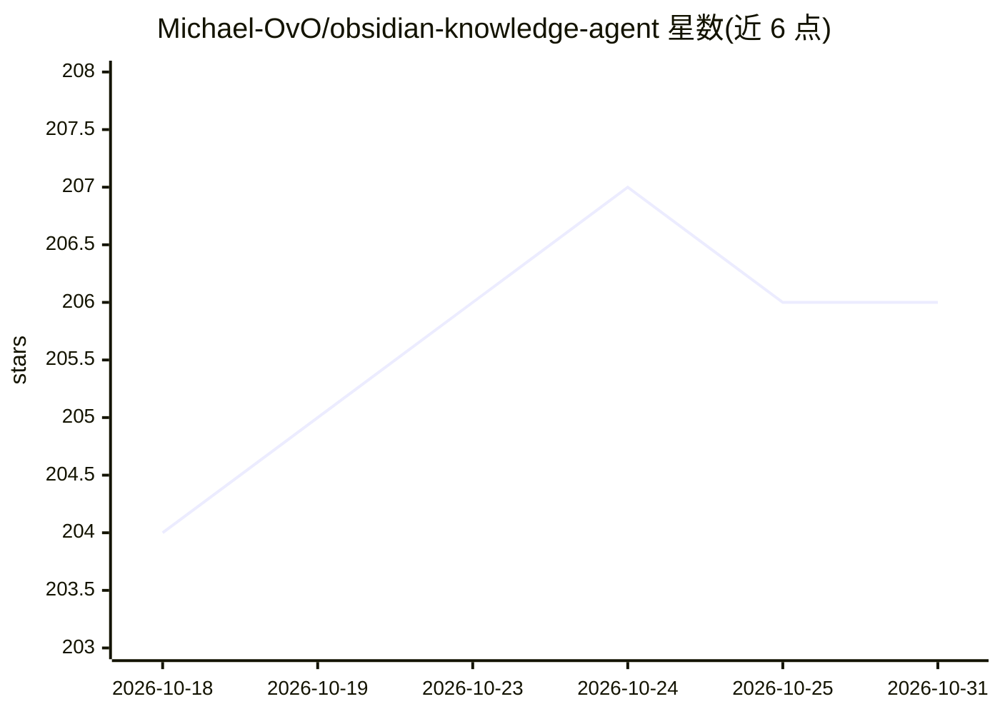

# Michael-OvO/obsidian-knowledge-agent

⭐ 206 · Python · MIT · 推送 2026-06-27 · [GitHub](https://github.com/Michael-OvO/obsidian-knowledge-agent) · 个人维护

**面向 Obsidian 库的 agent 笔记管线：整理原始资料为教学级笔记**

以纯 Markdown（AGENTS.md + .agents/）形式提供的 agent 规则与插件包，可运行于 Claude Code、OpenAI Codex、Cursor 等读取 AGENTS.md 的 agent。它将链接、PDF、讲义、教学大纲等原料按材料规模分档（Ingest→Compile→Distribute 六阶段管线）写入遵循用户库既有命名与 frontmatter 规范的笔记，3 单元以上集合生成概念图画布，并在提交前校验 wikilink 完整性。特色是自我演进机制：reflect 提出规则差异，用户以 evolve 审批后写入 .agents/learned/，下次运行自动召回。通过插件市场命令或 install.sh 安装。

## 筛选速览

| 维度 | 判定 | 备注 |
|---|---|---|
| AI 角色 | `ai-native` | 本体是模型或模型工具 |
| 许可风险 | `permissive` | MIT |
| 部署形态 | `library` | 以包/库形式分发 |
| 模型依赖 | locked-api |  |
| 硬件要求 | — | 无带数字的原话,不猜 |
| 安装摩擦 | `low` | 无编译、无系统依赖或容器化 |
| 成熟度 | — | 结构信号不足 |

## 能力要点

- 六阶段摄取管线按材料规模自适应（单条链接到整门课程）
- reflect/evolve 自我演进机制：修正以 git diff 审批后固化为规则
- 遵循库既有目录结构与 frontmatter 规范，不强制分类体系
- 并行多 agent 写笔记与质量检查，wikilink 校验支持 CI

## 适用场景

- 把论文、讲义、链接整理成结构化 Obsidian 笔记
- 让 agent 按自己库的习惯持续整理 Inbox 与日常记录
- 维护知识库健康（断链、孤立笔记、frontmatter 检查）

## 场景标签

`知识库管理` · 领域:知识与检索

## 证据(README 行号)

> L15: Point any agentic assistant at your Obsidian vault and **talk to it** — *"save this link"*, *"organize my inbox"*, 
> L145: The full pipeline (recall → ingest → compile → distribute → reflect) lives in `.agents/ingestion-workflow.md`. Lig

## 星数曲线

2026-10-18 204 → 2026-10-31 206（+2）

---
*卡片 v1 · prompt 1.4 · 生成 2026-10-22 · 置信度 mid · 依据 README sha `fff3e50f4831` · [字段定义](../../DATASET.md)*
