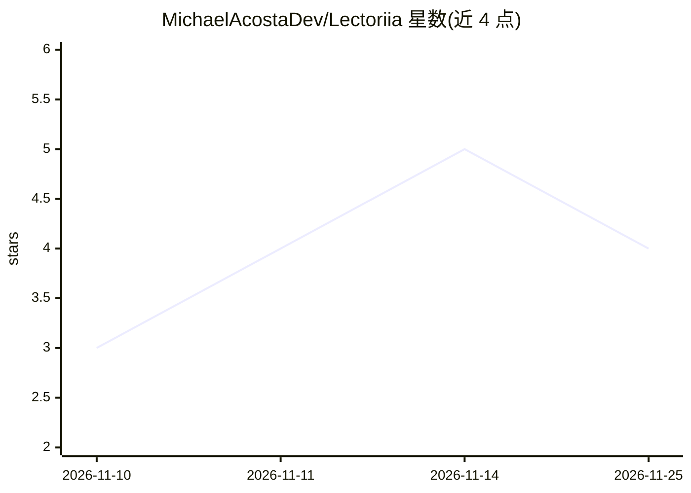

# MichaelAcostaDev/Lectoriia

⭐ 4 · Python · MIT · 推送 2026-11-11 · [GitHub](https://github.com/MichaelAcostaDev/Lectoriia) · [官网](https://lectoriia.vercel.app) · 个人维护

**无需外部 AI 的 PDF/文本阅读分析 Web 应用**

一个 Web 文档分析工具：上传 PDF 或粘贴文本，生成抽取式摘要、高频概念、主题建议，并用 BM25 风格排序从原文句子中选取答案、附页码引用。README 明确声明不使用生成式 AI 模型、不调用外部推理服务，全部依赖本地文本统计规则；扫描版 PDF 不做 OCR，文本上限 50 万字符/512 分块，PDF 上传 15 MB（本地）/4 MB（Vercel）。支持英/西双语界面与语言检测，MIT 协议，已部署于 Vercel。

## 筛选速览

| 维度 | 判定 | 备注 |
|---|---|---|
| AI 角色 | `ai-enhanced` | 去掉 AI 部分产品仍成立 |
| 许可风险 | `permissive` | MIT |
| 部署形态 | `None` |  |
| 模型依赖 | — | README 未给出锁定关系 |
| 硬件要求 | — | 无带数字的原话,不猜 |
| 安装摩擦 | `low` | 无编译、无系统依赖或容器化 |
| 成熟度 | — | 结构信号不足 |

## 能力要点

- 抽取式摘要与关键词，基于词项重要性与冗余控制
- BM25 风格句子检索问答，答案可回溯源文档页码
- 无外部 AI：不需账号、模型下载或推理 API key
- 英/西双语界面，含文档语言检测

## 适用场景

- 长报告快速抓住要点与主题
- 找到问题相关的原文段落并回溯源出处
- 避免文档内容发往第三方 AI 服务的前提下做初读分析

## 场景标签

`文档问答` · 领域:知识与检索

## 证据(README 行号)

> L27: **lectoriia is a small, thoughtful document companion** for that first pass. Add a PDF or paste text, and it brings
> L47: lectoriia does **not** use a generative AI model or call an external inference service. Its summaries rank source s
> L51: > **No AI account. No model download. No inference API key.**

## 星数曲线

2026-11-10 3 → 2026-11-25 4（+1）

---
*卡片 v1 · prompt 1.4 · 生成 2026-11-21 · 置信度 high · 依据 README sha `aeec4e70a827` · [字段定义](../../DATASET.md)*
