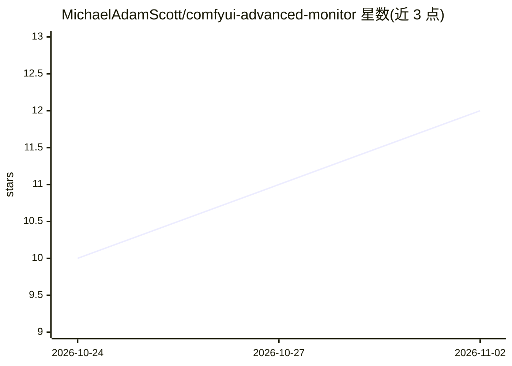

# MichaelAdamScott/comfyui-advanced-monitor

⭐ 12 · JavaScript · MIT · 推送 2026-07-07 · [GitHub](https://github.com/MichaelAdamScott/comfyui-advanced-monitor) · 个人维护

**ComfyUI 工具栏资源监控插件：CPU/RAM/GPU/VRAM/温度实时显示**

ComfyUI 的 custom_nodes 插件，在顶部工具栏以"pill"形式实时显示 CPU、RAM、GPU、VRAM、GPU 温度与磁盘占用，带实时 sparkline、彩色用量条与悬停精确值，超阈值（90%/85°C）变红警示。通过 psutil 与 NVML 采样，经 ComfyUI 现有 websocket 推送。点击 VRAM/RAM pill 可卸载模型、清空 CUDA 分配器缓存或清理执行缓存，操作由 prompt worker 处理保证执行安全。不添加工作流节点，纯工具栏 UI。无 NVIDIA GPU 时 GPU pill 不显示，CPU/RAM/Disk 仍可用。

## 筛选速览

| 维度 | 判定 | 备注 |
|---|---|---|
| AI 角色 | `ai-ecosystem` | LLM/agent 周边工具 |
| 许可风险 | `permissive` | MIT |
| 部署形态 | `desktop` | 安装包/桌面程序 |
| 模型依赖 | — | README 未给出锁定关系 |
| 硬件要求 | — | 无带数字的原话,不猜 |
| 安装摩擦 | `medium` | 含编译或系统依赖之一 |
| 成熟度 | — | 结构信号不足 |

## 能力要点

- 工具栏实时监控 CPU/RAM/GPU/VRAM/温度/磁盘，带 sparkline 与悬停精确值
- 一键卸载模型、清空 VRAM 缓存、清理 RAM 执行缓存，执行安全
- 多 NVIDIA GPU 各自独立显示；无 GPU 时降级运行
- 采样线程在无浏览器标签页连接时自动暂停

## 适用场景

- 生成图片时随时查看显存与内存占用
- 显存不足时从工具栏一键卸载模型或清缓存
- 多卡机器上分别监控每张 GPU 的利用率与温度

## 场景标签

 · 领域:AI 工作流工具/系统监控

## 证据(README 行号)

> L36: Multiple NVIDIA GPUs each get their own set of pills. No workflow nodes are added — this package is purely the tool
> L74: - `monitor.py` runs a daemon thread that samples stats with `psutil` (CPU/RAM/disk) and NVML (`nvidia-ml-py`) for G

## 星数曲线

2026-10-24 10 → 2026-11-02 12（+2）

---
*卡片 v1 · prompt 1.4 · 生成 2026-11-02 · 置信度 mid · 依据 README sha `da4c5de66524` · [字段定义](../../DATASET.md)*
