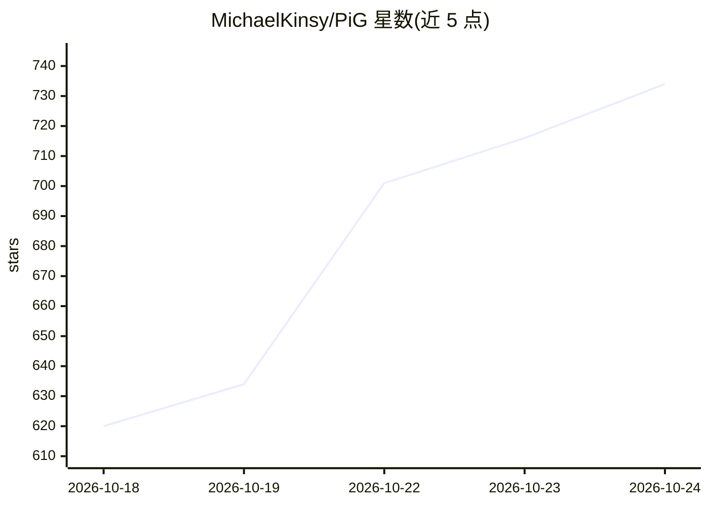

# MichaelKinsy/PiG

⭐ 734 · Go · MIT · 推送 2026-10-23 · [GitHub](https://github.com/MichaelKinsy/PiG) · [官网](https://pi-in-go.dev) · 个人维护

**终端极简编程 agent Pi 的 Go 移植版：单二进制、免 Node.js**

PiG 是上游 TypeScript 编写的终端编程 agent Pi 的 Go 平移移植，以固定 pin 的 Pi 1.3.0 为行为契约，通过配对 parity 场景核验一致性。产物为单一原生二进制 pig，无需 Node.js 即可运行 Pi 的 TypeScript 扩展，也支持用 Go/Rust/Python 编写扩展，并可把扩展、技能与提示词打包为可分享的 Piglet 组合。安装提供 curl 脚本、npm、go install 与源码构建四条途径；当前为 pre-stable 0.x 版本，Windows 支持处于 preview，未提供模型输出侧的安全沙箱。

## 筛选速览

| 维度 | 判定 | 备注 |
|---|---|---|
| AI 角色 | `ai-native` | 本体是模型或模型工具 |
| 许可风险 | `permissive` | MIT |
| 部署形态 | `library` | 以包/库形式分发 |
| 模型依赖 | — | README 未给出锁定关系 |
| 硬件要求 | — | 无带数字的原话,不猜 |
| 安装摩擦 | `low` | 无编译、无系统依赖或容器化 |
| 成熟度 | `idea` | |

## 能力要点

- 对 Pi 1.3.0+1402973a 做配对 parity 场景核验的移植
- 单二进制启动、无需 Node.js、可运行 Pi 的 TypeScript 扩展
- 支持 Go/Rust/Python/Node 扩展，可打包为 Piglet 组合并构建独立可执行
- macOS/Linux/Windows/Android(Termux) 多平台安装途径

## 适用场景

- 在终端以单二进制方式使用 Pi 编程 agent 而不装 Node.js
- 用 Go/Rust/Python 编写或复用 Pi 扩展与技能
- 把扩展、技能、提示词组合成可分享的命名 agent（Piglet）

## 场景标签

`编码 Agent` · 领域:编码与开发

## 证据(README 行号)

> L19: PiG is Pi, the minimal and extensible coding agent for the terminal, rebuilt in Go as one native binary. It starts 
> L55: Start PiG in the directory where you want it to work, run `/login` to connect a subscription or set your provider's
> L121: |`ai/`|Pi-compatible providers, model catalog, authentication, and streaming types.|

## 星数曲线

2026-10-18 620 → 2026-10-24 734（+114）

---
*卡片 v1 · prompt 1.4 · 生成 2026-10-21 · 置信度 high · 依据 README sha `f590121d7f3a` · [字段定义](../../DATASET.md)*
