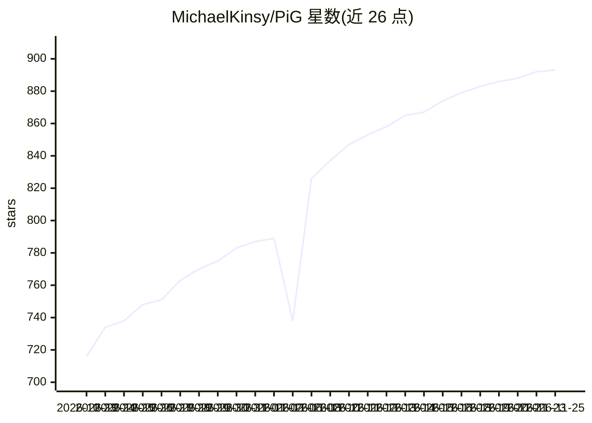

# MichaelKinsy/PiG

⭐ 893 · Go · MIT · 推送 2026-11-24 · [GitHub](https://github.com/MichaelKinsy/PiG) · [官网](https://pi-in-go.dev) · 个人维护

**用 Go 重写的 Pi 终端编码 agent，单二进制免 Node.js**

PiG 是上游 Pi（TypeScript 终端编码 agent）的 Go 移植，以行为对等（parity）为约束：固定 Pi 1.5.0 为行为基准，用配对场景验证，差异记录在案。单原生二进制启动，不需要 Node.js，可原样运行 Pi 的 TypeScript 扩展，也可用 Go/Rust/Python 编写扩展，并将扩展、技能、提示打包为 Piglet 形成可分享或独立可执行的单名 agent。当前为 0.x 前稳定版，边缘场景仍在加固，Windows 支持为预览；不实现上游实验性远程 Session 与独立遥测/评估包。

## 筛选速览

| 维度 | 判定 | 备注 |
|---|---|---|
| AI 角色 | `ai-native` | 本体是模型或模型工具 |
| 许可风险 | `permissive` | MIT |
| 部署形态 | `library` | 以包/库形式分发 |
| 模型依赖 | — | README 未给出锁定关系 |
| 硬件要求 | — | 无带数字的原话,不猜 |
| 安装摩擦 | `low` | 无编译、无系统依赖或容器化 |
| 成熟度 | `idea` | |

## 能力要点

- 单一 Go 原生二进制，无需 Node.js，运行 Pi 的 TypeScript 扩展无需改动
- 扩展 SDK 覆盖 Go、Rust、Python 及声明式 TypeScript
- Piglet 机制可将扩展、技能与提示打包为可分享的单名 agent
- 以固定 Pi 1.5.0 为行为基准，配对 parity 场景验证移植行为

## 适用场景

- 在终端里用编码 agent 处理日常代码任务
- 为团队打包一个含定制扩展与技能的单名 agent
- 给现有 Pi TypeScript 扩展提供 Go 运行环境

## 场景标签

`编码 Agent` `Agent 框架` · 领域:Agent 开发

## 证据(README 行号)

> L19: PiG is Pi, the minimal and extensible coding agent for the terminal, rebuilt in Go as one native binary. It starts 
> L104: PiG's current package scope covers Pi's agent, AI, coding-agent, and TUI

## 星数曲线

2026-10-23 716 → 2026-11-25 893（+177）

---
*卡片 v1 · prompt 1.4 · 生成 2026-11-24 · 置信度 high · 依据 README sha `63be7ff4dcfa` · [字段定义](../../DATASET.md)*
