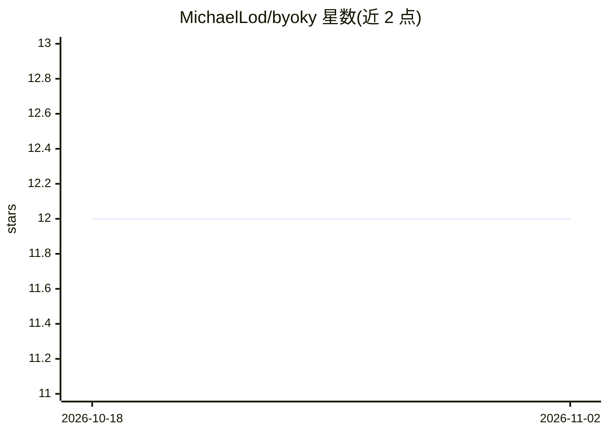

# MichaelLod/byoky

⭐ 12 · TypeScript · MIT · 推送 2026-11-01 · [GitHub](https://github.com/MichaelLod/byoky) · [官网](https://byoky.com) · 个人维护

**AI API 密钥钱包：密钥留在本地设备，代应用代理 LLM 调用**

Byoky（Bring Your Own Key）是面向 AI 应用用户的密钥钱包，形态为浏览器扩展与 iOS/Android 应用。用户将各家 API 密钥添加一次并在设备上 AES-256-GCM 加密保存，应用通过 SDK/bridge/中继连接钱包发起 LLM 调用，应用本身接触不到密钥。支持 Anthropic、OpenAI、Gemini 等 13 个提供商及自定义端点，可在不同提供商间实时翻译请求/响应/SSE 流。提供 npm 包、CLI bridge、开发者 SDK 与后端中继方案；无服务器、无账号、无云同步，MIT 许可。

## 筛选速览

| 维度 | 判定 | 备注 |
|---|---|---|
| AI 角色 | `ai-ecosystem` | LLM/agent 周边工具 |
| 许可风险 | `permissive` | MIT |
| 部署形态 | `library` | 以包/库形式分发 |
| 模型依赖 | locked-api |  |
| 硬件要求 | — | 无带数字的原话,不猜 |
| 安装摩擦 | `low` | 无编译、无系统依赖或容器化 |
| 成熟度 | — | 结构信号不足 |

## 能力要点

- 密钥仅存于设备，AES-256-GCM 加密，应用获得的是每会话令牌
- 13 个提供商 + 自定义端点，跨提供商请求/响应/SSE 实时翻译
- 应用分组管理、每应用消费上限、本地审计日志与一键撤销
- SDK 提供 createFetch() 作为 fetch 替换，兼容各提供商原生 SDK

## 适用场景

- 在多个 AI 应用间复用同一批 API 密钥而无需复制粘贴
- 开发者让自己的应用以两行代码接入用户的密钥（BYOK 模式）
- CLI/桌面/后端应用通过 localhost bridge 或 WebSocket 中继走用户钱包调用 LLM

## 场景标签

`模型网关` · 领域:Agent 开发

## 证据(README 行号)

> L16: **Byoky** (Bring Your Own Key) is a wallet for your AI credentials: a browser extension plus iOS and Android apps. 
> L30: 3. Open any Byoky-enabled app → approve access → the wallet proxies its calls
> L172: The SDK provides `createFetch()`, a drop-in `fetch` replacement that routes through the wallet. It works with **an

## 星数曲线

2026-10-18 12 → 2026-11-02 12（+0）

---
*卡片 v1 · prompt 1.4 · 生成 2026-11-01 · 置信度 high · 依据 README sha `597ef7dae5ed` · [字段定义](../../DATASET.md)*
