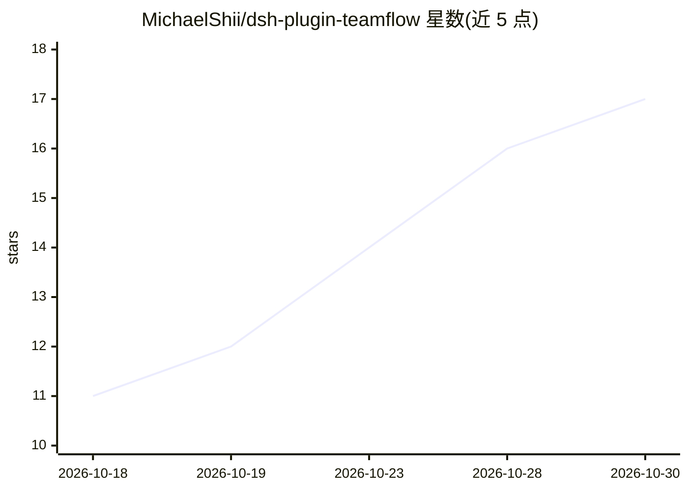

# MichaelShii/dsh-plugin-teamflow

⭐ 17 · TypeScript · MIT · 推送 2026-10-29 · [GitHub](https://github.com/MichaelShii/dsh-plugin-teamflow) · 个人维护 · 中文 README

**面向 DeepSeek Harness 的多 Agent 团队研发流水线插件**

以宿主级插件形式运行在 DeepSeek Harness（dsh）web profile 上的团队研发编排工具：把一句话需求自动拆解为 PRD→（可选）UI 设计→架构脚手架→并行开发→QA→验收的流水线，产品/架构/开发/QA 各阶段由独立上下文的子代理执行（默认 3 路并发，上限 8）。交付采用证据校验（命令+退出码+断言），QA 缺陷自动打回复验（≤2 轮），支持断点续跑与自动汇报，并提供会话内与全局的看板工作台、token 计量。限制：必须运行在 dsh 宿主环境（≥0.2.1-alpha.2），无法独立运行；开发者改源码后需 pnpm bundle 重建。

## 筛选速览

| 维度 | 判定 | 备注 |
|---|---|---|
| AI 角色 | `ai-native` | 本体是模型或模型工具 |
| 许可风险 | `permissive` | MIT |
| 部署形态 | `None` |  |
| 模型依赖 | locked-api |  |
| 硬件要求 | — | 无带数字的原话,不猜 |
| 安装摩擦 | `low` | 无编译、无系统依赖或容器化 |
| 成熟度 | `idea` | |

## 能力要点

- 需求→PRD→设计→开发→QA→验收全链路自动编排，含 patch/lite/tech/medium/full 分诊档位
- 防假交付：阶段须给出命令+退出码+断言数验证证据，QA 独立对抗探针
- 断点续跑：崩溃/重启后从第一个未完成阶段继续，已完成阶段复用产物
- Web 双入口工作台（流水线泳道图+拖拽 Backlog 看板+token 成本中心），中英双语

## 适用场景

- 用一句话需求驱动多 Agent 完成从 PRD 到验收的完整研发流程
- 通过看板工作台跟踪多个产品线的运行状态、token 消耗与任务流转
- 机械小改动用 patch/lite 档裁剪阶段，不跑完整瀑布

## 场景标签

`多智能体` `编码 Agent` · 领域:Agent 开发

## 证据(README 行号)

> L9: 把「用户一句话需求 → 真实研发团队多 Agent 流水线」做成宿主级能力：
> L46: - **一句话需求 → 可验收的交付**：从需求到 PRD / 技术方案 / 并行开发 / QA / 验收全链路自动编排，每个阶段有任务卡、有产物、有结论；机械小改动可用 `patch` / `lite` 档裁剪阶段集，不必为一行
> L48: - **防假交付**：交付看证据不看措辞——阶段必须给出「命令 + 退出码 + 断言数」的验证证据，QA 有独立对抗探针，验收只认显式结论行（缺失即停线转人工）。

## 星数曲线

2026-10-18 11 → 2026-10-30 17（+6）

---
*卡片 v1 · prompt 1.4 · 生成 2026-10-30 · 置信度 high · 依据 README sha `40b83aca8793` · [字段定义](../../DATASET.md)*
