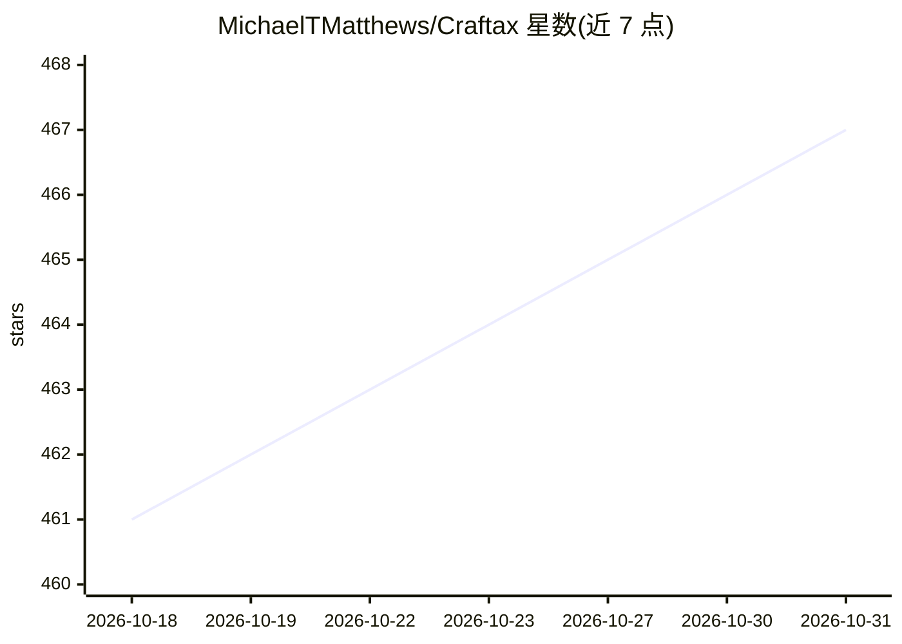

# MichaelTMatthews/Craftax

⭐ 467 · Python · MIT · 推送 2026-10-27 · [GitHub](https://github.com/MichaelTMatthews/Craftax) · 组织维护

**纯 JAX 实现的开放式强化学习基准环境**

用 JAX 重实现并扩展 Crafter 游戏机制的强化学习环境，参考 NetHack 等 roguelike 游戏，提供 Craftax 与 Craftax-Classic 两个版本。遵循 gymnax 接口，可与 PureJaxRL、JaxUED 等 JAX 框架集成；支持乐观重置（非自动重置需用 wrapper 包装）、纹理缓存机制，附人类轨迹离线数据集与算法记分板。ICML 2024 论文发表，供 RL 算法评测研究使用。

## 筛选速览

| 维度 | 判定 | 备注 |
|---|---|---|
| AI 角色 | `ai-ecosystem` | LLM/agent 周边工具 |
| 许可风险 | `permissive` | MIT |
| 部署形态 | `library` | 以包/库形式分发 |
| 模型依赖 | — | README 未给出锁定关系 |
| 硬件要求 | — | 无带数字的原话,不猜 |
| 安装摩擦 | `low` | 无编译、无系统依赖或容器化 |
| 成熟度 | — | 结构信号不足 |

## 能力要点

- 完全用 JAX 实现的 RL 环境，遵循 gymnax 接口
- 提供 Craftax-1B/1M 算法记分板（未验证外部结果）
- 含混合技能人类轨迹离线数据集
- 乐观重置选项与纹理缓存机制

## 适用场景

- 评测与比较强化学习算法在开放式任务上的表现
- 在 JAX 生态中做向量化 RL 训练实验
- 使用人类轨迹数据做离线 RL 研究

## 场景标签

`模型评测` `强化学习` · 领域:评测与运维

## 证据(README 行号)

> L17: Craftax is an RL environment written entirely in JAX. Craftax reimplements and significantly extends the game mecha
> L18: Craftax conforms to the gymnax interface, allowing easy integration with existing JAX-based frameworks like PureJax
> L83: # 📋 Scoreboard

## 星数曲线

2026-10-18 461 → 2026-10-31 467（+6）

---
*卡片 v1 · prompt 1.4 · 生成 2026-10-21 · 置信度 high · 依据 README sha `17198f5fd9aa` · [字段定义](../../DATASET.md)*
