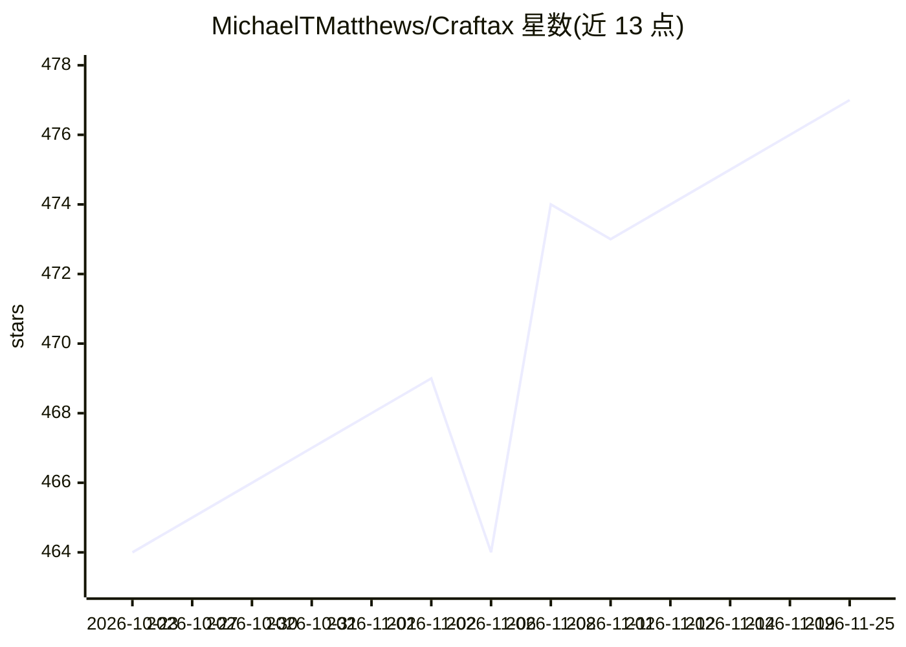

# MichaelTMatthews/Craftax

⭐ 477 · Python · MIT · 推送 2026-10-27 · [GitHub](https://github.com/MichaelTMatthews/Craftax) · 组织维护

**JAX 编写的开源强化学习环境，供 RL 研究训练与评测**

用 JAX 实现的强化学习环境，重新实现并扩展了 Crafter 的游戏机制，借鉴 NetHack 等 roguelike 游戏，提供 Craftax 与 Craftax-Classic 两个版本。符合 gymnax 接口，可与 PureJaxRL、JaxUED 等 JAX 框架集成；支持将观测渲染为文本供语言 agent 使用，附带人类轨迹离线数据集、算法得分榜与论文勘误记录。从 PyPI 安装，默认 CPU 版 JAX，GPU/TPU 需自行安装对应 JAX wheel；首次运行需约数十秒编译渲染与 step 函数。

## 筛选速览

| 维度 | 判定 | 备注 |
|---|---|---|
| AI 角色 | `ai-native` | 本体是模型或模型工具 |
| 许可风险 | `permissive` | MIT |
| 部署形态 | `library` | 以包/库形式分发 |
| 模型依赖 | — | README 未给出锁定关系 |
| 硬件要求 | — | 无带数字的原话,不猜 |
| 安装摩擦 | `low` | 无编译、无系统依赖或容器化 |
| 成熟度 | — | 结构信号不足 |

## 能力要点

- 完全用 JAX 编写，符合 gymnax 接口，可集成 PureJaxRL/JaxUED
- 支持 glyph 文本渲染供语言 agent 使用
- 提供 Craftax-1B/1M 算法得分榜与人类轨迹离线数据集
- ICML 2024 论文附 arXiv 链接与引用条目

## 适用场景

- 在 JAX 生态中训练和评测 RL 算法
- 测试语言 agent 在文本观测环境下的能力
- 作为开放式强化学习基准对比论文结果

## 场景标签

`强化学习` `模型评测` · 领域:评测与运维

## 证据(README 行号)

> L17: Craftax is an RL environment written entirely in JAX. Craftax reimplements and significantly extends the game mecha
> L21: Craftax conforms to the gymnax interface:

## 星数曲线

2026-10-23 464 → 2026-11-25 477（+13）

---
*卡片 v1 · prompt 1.4 · 生成 2026-11-25 · 置信度 high · 依据 README sha `2c0bd75a3658` · [字段定义](../../DATASET.md)*
