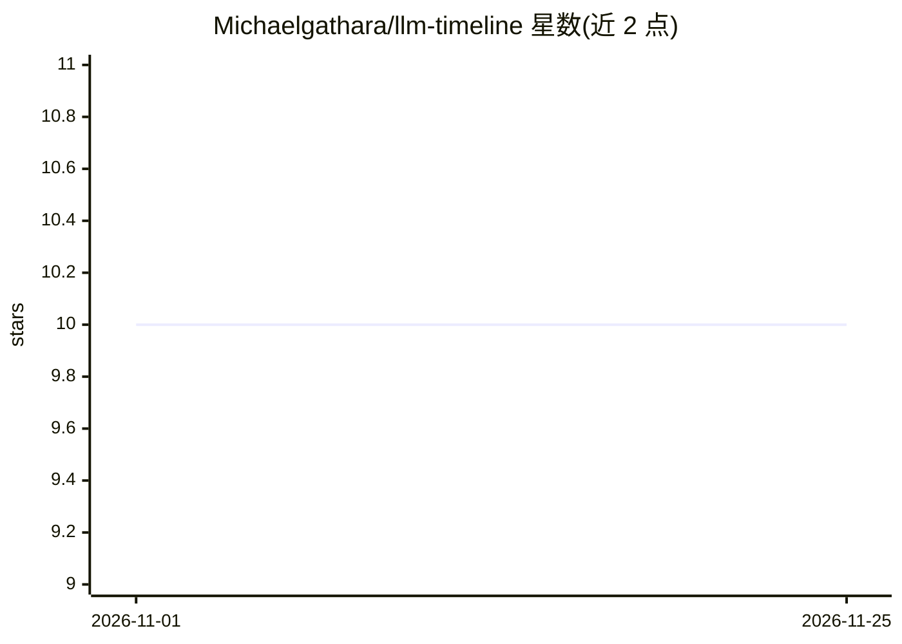

# Michaelgathara/llm-timeline

⭐ 10 · TypeScript · Apache-2.0 · 推送 2026-06-17 · [GitHub](https://github.com/Michaelgathara/llm-timeline) · [官网](https://llmtimeline.web.app) · 个人维护

**面向研究者与开发者的 LLM 发展史交互式可视化网站**

基于 Next.js/TypeScript 的 Web 应用，以交互式 SVG 时间线呈现 2017 年 Transformer 架构至今的大语言模型发展脉络：不同模型架构与路线按颜色分支展示，节点包含各模型的创新点信息与模型间继承关系连线，并附论文与资源链接。数据存于静态 TypeScript 文件，社区通过编辑 timelineData.ts 添加新模型条目。依赖 Node.js v18+ 运行，提供线上演示站点。

## 筛选速览

| 维度 | 判定 | 备注 |
|---|---|---|
| AI 角色 | `ai-knowledge` | 知识聚合/清单类 |
| 许可风险 | `permissive` | Apache-2.0 |
| 部署形态 | `library` | 以包/库形式分发 |
| 模型依赖 | — | README 未给出锁定关系 |
| 硬件要求 | — | 无带数字的原话,不猜 |
| 安装摩擦 | `low` | 无编译、无系统依赖或容器化 |
| 成熟度 | — | 结构信号不足 |

## 能力要点

- 交互式 SVG 时间线，按架构/路线颜色分支展示模型演化
- 节点附带创新点说明、继承关系连线及原论文链接
- 数据为静态 TypeScript 文件，编辑 timelineData.ts 即可贡献新条目
- 响应式设计并提供线上演示地址

## 适用场景

- 梳理 LLM 领域各架构的发展与相互借鉴关系
- 查找某个里程碑模型对应的原论文
- 为模型演化研究或教学准备可视化素材

## 场景标签

`教程课程` `科研工具` · 领域:学习与行业

## 证据(README 行号)

> L3: An interactive visualization of the evolution of Large Language Models from the Transformer architecture in 2017 to 
> L9: LLM Timeline is a web application that visually maps the development history of large language models, showing how d
> L29: - **Data**: Static TypeScript files (timelineData.ts)

## 星数曲线

2026-11-01 10 → 2026-11-25 10（+0）

---
*卡片 v1 · prompt 1.4 · 生成 2026-11-20 · 置信度 high · 依据 README sha `0b22e23a73ce` · [字段定义](../../DATASET.md)*
