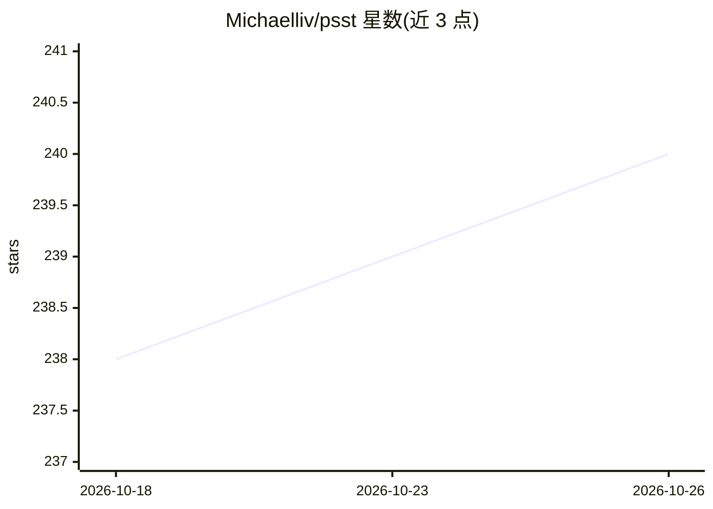

# Michaelliv/psst

⭐ 240 · TypeScript · MIT · 推送 2026-05-24 · [GitHub](https://github.com/Michaelliv/psst) · 个人维护

**面向 AI agent 的密钥管理 CLI：agent 用密钥而不见密钥**

本地优先的密钥管理工具，设计目标是不让 AI agent 接触明文密钥：通过 psst run 或 psst SECRET -- cmd 把密钥在运行时注入子进程环境，命令输出自动以 [REDACTED] 遮蔽密钥。默认用本地 SQLite 库（AES-256-GCM 加密，密钥存 OS 钥匙串），可切换 AWS Secrets Manager 后端用于 EC2/团队共享。支持多环境（dev/prod）、标签、版本历史与回滚、基于真实密钥值的 git 泄露扫描，另有需 Bun 运行时的 TypeScript SDK；无钥匙串的 CI 环境可用 PSST_PASSWORD。

## 筛选速览

| 维度 | 判定 | 备注 |
|---|---|---|
| AI 角色 | `ai-ecosystem` | LLM/agent 周边工具 |
| 许可风险 | `permissive` | MIT |
| 部署形态 | `self-host` | docker 或自建部署 |
| 模型依赖 | — | README 未给出锁定关系 |
| 硬件要求 | — | 无带数字的原话,不猜 |
| 安装摩擦 | `low` | 无编译、无系统依赖或容器化 |
| 成熟度 | — | 结构信号不足 |

## 能力要点

- 密钥注入子进程环境，不进入 agent 上下文，输出自动遮蔽
- 默认本地加密 SQLite + OS 钥匙串，可插拔 AWS Secrets Manager 后端
- 多环境、标签过滤、保留最近 10 个版本并支持回滚
- 按真实密钥值（非正则）扫描 git 暂存/追踪文件防泄露

## 适用场景

- 让编程 agent 执行需要 API key 的命令而不把 key 粘贴进上下文
- 按 dev/staging/prod 环境隔离管理本地项目密钥
- EC2 或团队场景下用 AWS Secrets Manager 共享密钥
- 提交前扫描代码里是否泄露了库中密钥

## 场景标签

`网络安全` · 领域:学习与行业

## 证据(README 行号)

> L223: ## For Agents
> L363: - **Agent-first**: Designed for AI agents to use, not just humans.

## 星数曲线

2026-10-18 238 → 2026-10-26 240（+2）

---
*卡片 v1 · prompt 1.4 · 生成 2026-10-22 · 置信度 mid · 依据 README sha `a45ceed1a8c1` · [字段定义](../../DATASET.md)*
