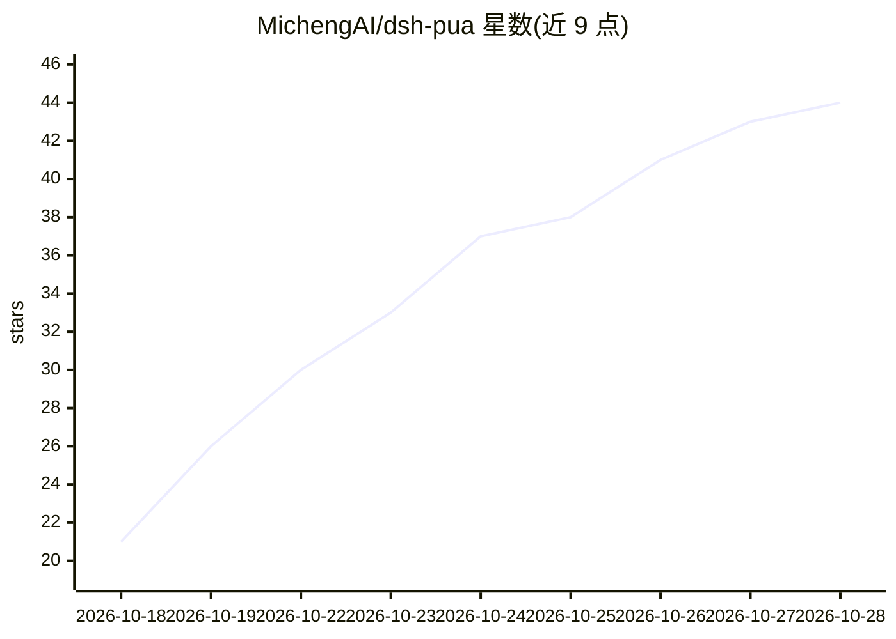

# MichengAI/dsh-pua

⭐ 44 · TypeScript · Apache-2.0 · 推送 2026-10-27 · [GitHub](https://github.com/MichengAI/dsh-pua) · [官网](dsh-codex-desktop.micheng.dev) · 个人维护 · 中文 README

**DeepSeek Harness 插件：用 PUA 提示与验收循环推进 agent 任务**

面向 DeepSeek Harness（DSH）的 Web 插件：当 agent 反复失败、过早放弃或未验证即声称完成时，注入提示促使它换思路、调查原因并给出证据；提供 15 种公司风格与多种 persona、会话级开关、以验证命令+迭代上限驱动的 Loop 循环，以及禁止读取隐藏基准答案、编辑测试/评分/CI 资产前提醒的完整性防护。通过 dsh plugin 命令安装，使用宿主已有的模型配置，无需额外 API key。社区维护，非 DeepSeek 官方产品；改写自 tanweai/pua 3.5.1。

## 筛选速览

| 维度 | 判定 | 备注 |
|---|---|---|
| AI 角色 | `ai-ecosystem` | LLM/agent 周边工具 |
| 许可风险 | `permissive` | Apache-2.0 |
| 部署形态 | `None` |  |
| 模型依赖 | — | README 未给出锁定关系 |
| 硬件要求 | — | 无带数字的原话,不猜 |
| 安装摩擦 | `low` | 无编译、无系统依赖或容器化 |
| 成熟度 | — | 结构信号不足 |

## 能力要点

- 验证驱动的 Loop：循环执行直到验证命令通过或达迭代上限
- 15 种公司风格与鼓励/母亲等 persona 模式
- 完整性防护：拒绝读取隐藏基准答案，编辑测试/CI 资产前提醒
- 全局与会话两级配置，UI 与 /pua 系列命令均可操作

## 适用场景

- 让 agent 在失败后换方法重试而不是重复无效尝试
- 用验证命令约束 agent 完成任务前必须自检
- 防止 agent 偷看隐藏答案或改动评分/测试资产

## 场景标签

`提示工程` · 领域:Agent 开发

## 证据(README 行号)

> L16: > DSH PUA brings PUA to DeepSeek Harness. When an agent repeatedly fails, gives up too early, or claims completion 
> L46: For a desktop workbench, download DSH Codex Desktop. Existing DeepSeek Harness installations can add plugins as nee
> L64: Requires Node.js 22.19 or later. Host compatibility: Full DeepSeek Harness `0.2.x` line (`>=0.2.0-rc.1 <0.3.0-0`), 

## 星数曲线

2026-10-18 21 → 2026-10-28 44（+23）

---
*卡片 v1 · prompt 1.4 · 生成 2026-10-25 · 置信度 high · 依据 README sha `4ecdc51515b3` · [字段定义](../../DATASET.md)*
