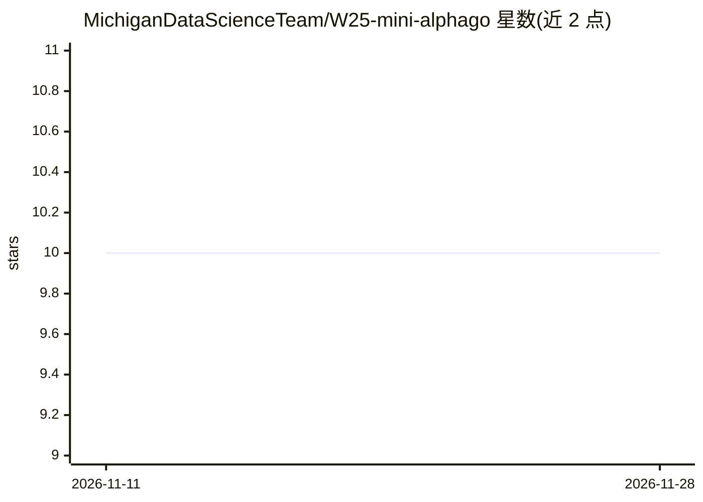

# MichiganDataScienceTeam/W25-mini-alphago

⭐ 10 · Python · MIT · 推送 2026-11-14 · [GitHub](https://github.com/MichiganDataScienceTeam/W25-mini-alphago) · 组织维护

**学生团队从零实现 9x9 围棋 AlphaGo 复现项目**

密歇根大学数据科学团队的教学项目，用 PyTorch 与 NumPy 实现 AlphaGo/AlphaGo Zero 混合方案：按 Tromp-Taylor 规则的围棋核心库、SGF 棋谱数据处理、ResNet 式策略价值网络、MCTS（以网络价值估计替代 rollout）、监督与强化学习训练脚本（多进程自我对弈）、Elo 评估与交互式网页可视化。附十周课程日程与幻灯片，训练依赖 MIDAS、U-M HPC 与 Google Cloud 算力。README 未提供安装命令。

## 筛选速览

| 维度 | 判定 | 备注 |
|---|---|---|
| AI 角色 | `ai-native` | 本体是模型或模型工具 |
| 许可风险 | `permissive` | MIT |
| 部署形态 | `None` |  |
| 模型依赖 | — | README 未给出锁定关系 |
| 硬件要求 | — | 无带数字的原话,不猜 |
| 安装摩擦 | `low` | 无编译、无系统依赖或容器化 |
| 成熟度 | — | 结构信号不足 |

## 能力要点

- 按 Tromp-Taylor 规则实现的围棋核心库，基于 NumPy 处理棋盘状态
- MCTS 实现中以神经网络价值估计替代 rollout
- 监督学习与强化学习训练脚本，mp 前缀文件支持多进程自我对弈
- 交互式网页界面可视化策略、价值与搜索树状态

## 适用场景

- 学习 AlphaGo/AlphaGo Zero 的完整实现流程
- 在 9x9 围棋上运行自我对弈与强化学习训练
- 教学场景中演示 MCTS 与策略价值网络协作机制

## 场景标签

`教程课程` `强化学习` · 领域:学习与行业

## 证据(README 行号)

> L3: We built a modified hybrid of AlphaGo and AlphaGo Zero for 9x9 Go using only computational libraries
> L21: <ins>**Neural Network**</ins> {<small>`network.py`</small>}
> L33: <ins>**Training**</ins> {<small>`supervised_learning.py`, `reinforcement_learning.py`, `train_alphago.py`, `mp_self

## 星数曲线

2026-11-11 10 → 2026-11-28 10（+0）

---
*卡片 v1 · prompt 1.4 · 生成 2026-11-20 · 置信度 high · 依据 README sha `33806fe727e6` · [字段定义](../../DATASET.md)*
