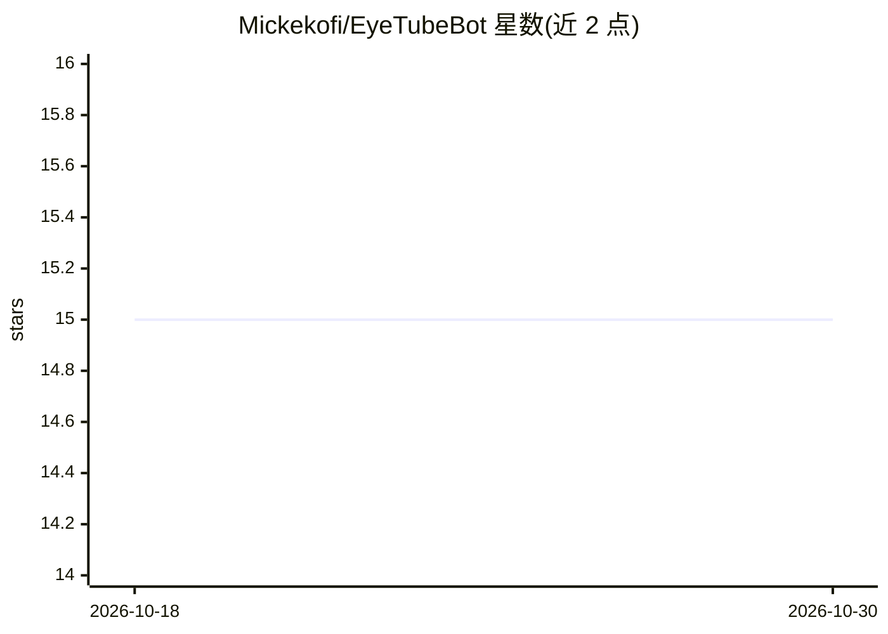

# Mickekofi/EyeTubeBot

⭐ 15 · Python · AGPL-3.0 · 推送 2025-12-13 · [GitHub](https://github.com/Mickekofi/EyeTubeBot) · [官网](https://t.me/EyeTubeAiBot) · 个人维护

**下载与处理社交媒体内容的 Telegram 机器人**

面向 Telegram 用户的机器人：下载和处理社交媒体内容，包括视频、音乐、图片、缩略图与元数据，并支持图片处理功能。产品分两版：商业用户版（3.0.0，经 Telegram 内托管服务提供）与开源核心版（2.0.1，供开发者克隆、本地运行与二次开发）。开源版基于 Python 3 与 Telegram Bot API token，通过 git clone、虚拟环境、pip 安装依赖后运行 eyetube.py；README 提及使用 YLT、pytelegram 库，致谢 yt-dlp。

## 筛选速览

| 维度 | 判定 | 备注 |
|---|---|---|
| AI 角色 | `ai-enhanced` | 去掉 AI 部分产品仍成立 |
| 许可风险 | `viral` | AGPL-3.0 |
| 部署形态 | `library` | 以包/库形式分发 |
| 模型依赖 | — | README 未给出锁定关系 |
| 硬件要求 | — | 无带数字的原话,不猜 |
| 安装摩擦 | `low` | 无编译、无系统依赖或容器化 |
| 成熟度 | — | 结构信号不足 |

## 能力要点

- 下载处理视频、音乐、图片、缩略图与元数据
- 支持图片处理功能
- 双形态：Telegram 托管商业版与开源核心版
- 开发者可经 git clone + pip requirements 本地运行

## 适用场景

- 在 Telegram 里下载社交媒体视频与音乐
- 获取媒体文件的缩略图和元数据
- 开发者克隆开源版自行部署与定制机器人

## 场景标签

 · 领域:社交媒体工具/机器人

## 证据(README 行号)

> L22: EyeTubeBot is a Telegram bot designed for downloading and processing social media content, including videos, music,
> L28:  ```EyeTubeBot is a Telegram AI Bot built with an Interactive User Interface which features automated Internet and 

## 星数曲线



2026-10-18 15 → 2026-10-30 15（+0）


---
*卡片 v1 · prompt 1.4 · 生成 2026-10-30 · 置信度 low · 依据 README sha `59100ebcec14` · [字段定义](../../DATASET.md)*
