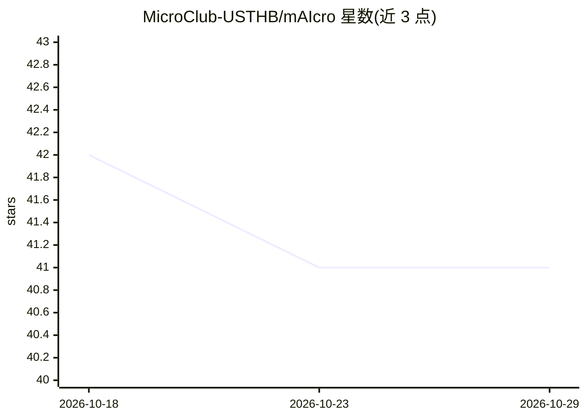

# MicroClub-USTHB/mAIcro

⭐ 41 · Python · MIT · 推送 2026-03-30 · [GitHub](https://github.com/MicroClub-USTHB/mAIcro) · 组织维护

**面向社区与组织的 RAG 知识问答服务（基于 Discord）**

由 MicroClub（USTHB 计算机社团）开发部门维护的开源 AI 服务：通过 Discord Bot 实时同步频道消息（处理创建/编辑/删除事件），转换为 LangChain 文档并生成嵌入存入 Qdrant，用 Google Gemini 做混合检索（向量+BM25+RRF）回答问题，支持时间类查询与俚语改写。采用无状态架构，游标与向量均存于 Qdrant Cloud。以 FastAPI 服务与 Docker 镜像形式提供，需配置 Gemini、Qdrant、Discord 凭证。

## 筛选速览

| 维度 | 判定 | 备注 |
|---|---|---|
| AI 角色 | `ai-native` | 本体是模型或模型工具 |
| 许可风险 | `permissive` | MIT |
| 部署形态 | `self-host` | docker 或自建部署 |
| 模型依赖 | — | README 未给出锁定关系 |
| 硬件要求 | — | 无带数字的原话,不猜 |
| 安装摩擦 | `low` | 无编译、无系统依赖或容器化 |
| 成熟度 | — | 结构信号不足 |

## 能力要点

- Discord Gateway WebSocket 实时同步消息（含启动时离线编辑/删除审计）
- Gemini + 混合检索（语义向量 + BM25 + Reciprocal Rank Fusion）
- 无状态架构：所有游标与向量存于 Qdrant Cloud，无本地数据库
- 限流应对：指数退避 + 可选备用 Gemini key 自动回退

## 适用场景

- 学生社团把 Discord 频道变成活动/FAQ 问答入口
- 企业或 NGO 集中内部公告与文档并即时问答
- 开发者社区基于历史讨论做技术问答

## 场景标签

`RAG` `文档问答` · 领域:知识与检索

## 证据(README 行号)

> L7: **mAIcro** is an open-source AI service designed to centralize organizational knowledge and answer questions via RAG
> L13: - **RAG-Powered Q&A**: Google Gemini with hybrid search (semantic vector + keyword BM25) and Reciprocal Rank Fusion
> L129: |`POST`|`/api/v1/ask`|Answer a question via RAG|

## 星数曲线

2026-10-18 42 → 2026-10-29 41（-1）

---
*卡片 v1 · prompt 1.4 · 生成 2026-10-25 · 置信度 high · 依据 README sha `6413c2f82d21` · [字段定义](../../DATASET.md)*
