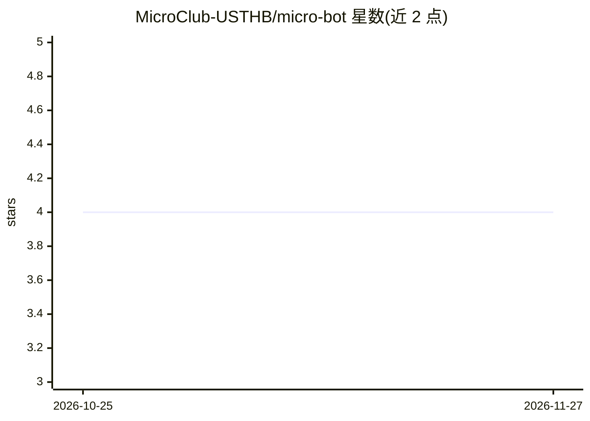

# MicroClub-USTHB/micro-bot

⭐ 4 · Python · 推送 2026-11-01 · [GitHub](https://github.com/MicroClub-USTHB/micro-bot) · [官网](https://micro-bot.microclub.info) · 组织维护

**Micro Club 社团的文档问答 RAG 助手：带来源引用**

USTHB Micro Club 学生社团的 AI 问答助手：管理员上传社团文档，用户用阿拉伯语、法语、英语、阿尔及利亚 darija/arabizi 提问，获得带来源引用的回答或明确的"文档中无答案"。机制上每问至多 2 次 LLM 调用（重写+回答），Qdrant 中做稠密（bge-m3）+BM25 混合检索、RRF 融合、cross-encoder 重排；无 GPU，嵌入/重排/OCR 均在容器内 CPU 运行；支持 SSE 流式输出。限制：全部文档对所有聊天用户公开。

## 筛选速览

| 维度 | 判定 | 备注 |
|---|---|---|
| AI 角色 | `ai-native` | 本体是模型或模型工具 |
| 许可风险 | `none` | — |
| 部署形态 | `self-host` | docker 或自建部署 |
| 模型依赖 | — | README 未给出锁定关系 |
| 硬件要求 | `cpu-ok` | |
| 安装摩擦 | `low` | 无编译、无系统依赖或容器化 |
| 成熟度 | — | 结构信号不足 |

## 能力要点

- 多语言混合提问，查询重写实现跨语言检索（法语文档回答阿拉伯语问题）
- 每条回答附带来源引用，无法回答时明确拒绝而非编造
- 三档免费 LLM 通道（Gemini/Cloudflare/OpenRouter）轮换，每日 1500 次上限
- 支持 PDF/扫描件/OCR/Office/Markdown/网页等文档类型，SSE 流式输出

## 适用场景

- 为社团/组织搭建有据可查的文档问答机器人
- 低预算环境下用免费 API 额度运行 RAG 服务
- 阿拉伯语/darija 与法语混合场景的跨语言文档检索

## 场景标签

`文档问答` `RAG` · 领域:知识与检索

## 证据(README 行号)

> L5:  The AI assistant of Micro Club (USTHB, Algiers).
> L6:  Upload the club's documents, ask in Arabic, French, darija, arabizi or English, and get a
> L86: 2. **Retrieve**: dense (bge-m3) and BM25 search in Qdrant, fused with RRF (expired documents filtered

## 星数曲线

2026-10-25 4 → 2026-11-27 4（+0）

---
*卡片 v1 · prompt 1.4 · 生成 2026-11-21 · 置信度 high · 依据 README sha `323503fd31ce` · [字段定义](../../DATASET.md)*
