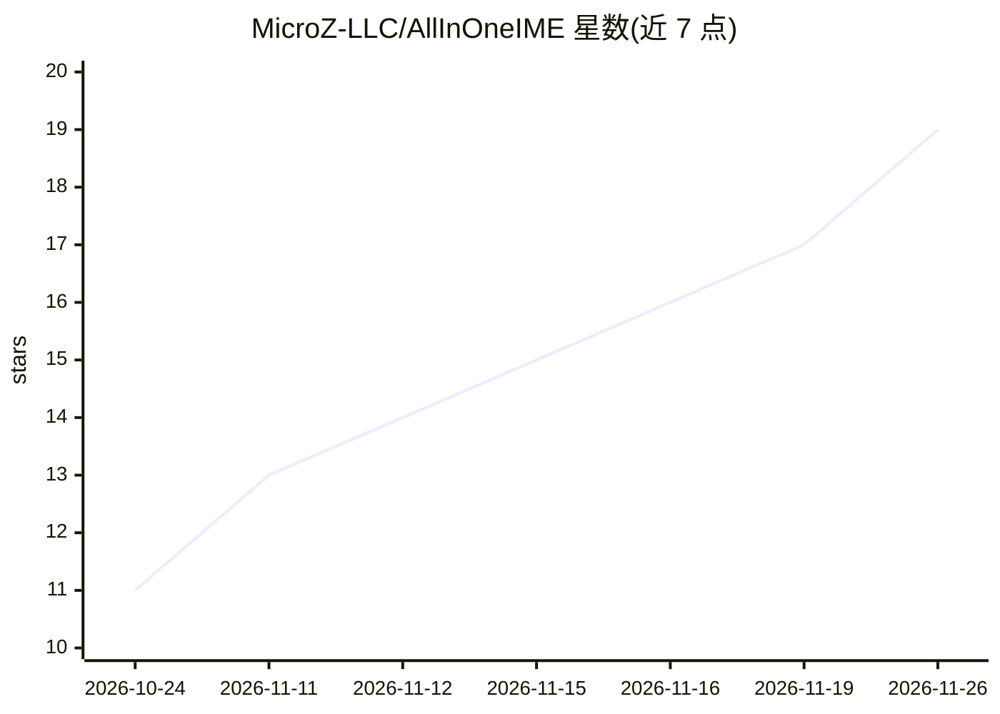

# MicroZ-LLC/AllInOneIME

⭐ 19 · Swift · NOASSERTION · 推送 2026-11-25 · [GitHub](https://github.com/MicroZ-LLC/AllInOneIME) · [官网](https://allinoneime.com) · 组织维护 · 中文 README

**带 AI 命令的 macOS 输入法：任意输入框内改写/翻译/提问**

macOS 原生输入法（Swift，基于 Rime/rime-ice 的拼音），本体是多语言文字输入（中文拼音、法语、韩文、印地文）。AI 功能以 `@` 命令嵌入任意文本框：@improve 润色改写、@translate 翻译、@question 问答（最多 5 轮对话）、@reply 生成回复、@agent 移交本机编码代理（Claude Code/Gemini CLI/Kiro CLI）、@open 查找打开文件。使用用户自备的 AI provider 与密钥。要求 macOS 14+，Apple 公证，Apple silicon 与 Intel 均可，从 GitHub Releases 下载安装。另支持自定义脚本命令与剪贴板历史。

## 筛选速览

| 维度 | 判定 | 备注 |
|---|---|---|
| AI 角色 | `ai-enhanced` | 去掉 AI 部分产品仍成立 |
| 许可风险 | `none` | NOASSERTION |
| 部署形态 | `None` |  |
| 模型依赖 | — | README 未给出锁定关系 |
| 硬件要求 | — | 无带数字的原话,不猜 |
| 安装摩擦 | `low` | 无编译、无系统依赖或容器化 |
| 成熟度 | — | 结构信号不足 |

## 能力要点

- 任意应用文本框内通过 @improve/@translate/@question/@reply 调用 AI
- @agent 可将任务移交本机 Claude Code、Gemini CLI、Kiro CLI 等编码代理
- 完整拼音输入法（基于 Rime 与 rime-ice），兼法语/韩文/印地文输入
- 魔法键可改（@/#/% 等），剪贴板历史（⌃V）与自定义脚本命令

## 适用场景

- 在邮件、聊天等任意输入框里直接润色或翻译刚写的句子
- 不切换应用就地提问并获得候选面板中的答案
- 用 @reply 依据对方消息生成三种语气回复
- 日常作为拼音等多语言输入法使用

## 场景标签

`AI 写作` `AI 助手` · 领域:对话与助手

## 证据(README 行号)

> L36: (pinyin, built on Rime and rime-ice), French, Korean (Hangul) and Hindi (Devanagari from Latin letters), and runs
> L48: Without `@`, it stays out of the way: in English, letters are typed directly and ⏎ is Return; nothing goes online.

## 星数曲线

2026-10-24 11 → 2026-11-26 19（+8）

---
*卡片 v1 · prompt 1.4 · 生成 2026-11-18 · 置信度 high · 依据 README sha `5a6b6761827d` · [字段定义](../../DATASET.md)*
