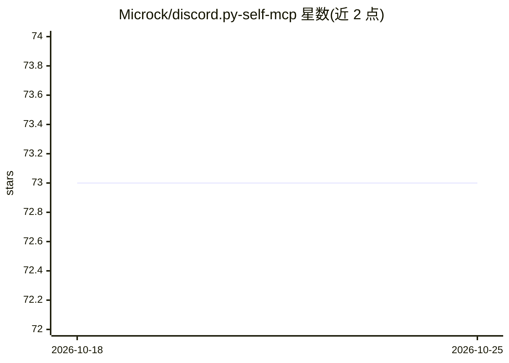

# Microck/discord.py-self-mcp

⭐ 73 · Python · MIT · 推送 2026-09-26 · [GitHub](https://github.com/Microck/discord.py-self-mcp) · [官网](https://www.npmjs.com/package/discord-selfbot-mcp) · 个人维护

**让 AI 助手操作个人 Discord 账号的 MCP 服务器**

基于 discord.py-self 库的本地 MCP 服务器（默认 stdio 传输，可选 Streamable HTTP），在 Claude Code、OpenCode、Codex 等 AI 客户端与用户个人 Discord 账号之间充当桥接：以 selfbot 方式运行，暴露约 60 个工具，覆盖消息读写、频道与角色权限管理、DM、语音、斜杠命令、按钮/菜单/模态交互、服务器文件夹整理与 discrawl 检索等。提供 npm 包装器与 pip/uv 两种安装路径，并带交互式 setup 脚本提取 token 生成配置。README 明示自动化用户账号违反 Discord ToS，需自担风险。

## 筛选速览

| 维度 | 判定 | 备注 |
|---|---|---|
| AI 角色 | `ai-ecosystem` | LLM/agent 周边工具 |
| 许可风险 | `permissive` | MIT |
| 部署形态 | `library` | 以包/库形式分发 |
| 模型依赖 | — | README 未给出锁定关系 |
| 硬件要求 | — | 无带数字的原话,不猜 |
| 安装摩擦 | `low` | 无编译、无系统依赖或容器化 |
| 成熟度 | — | 结构信号不足 |

## 能力要点

- 以 selfbot 身份运行，AI 可读取 DM、回复消息、管理服务器与交互组件
- 约 60 个工具覆盖消息、角色权限、线程、邀请、服务器文件夹与 discrawl 检索
- 支持 stdio 与 Streamable HTTP 两种传输，默认仅监听 localhost
- npm 包装器与 pip/uv 安装，setup 脚本自动生成 MCP 客户端配置

## 适用场景

- 让 AI 助手代为整理大型服务器列表与文件夹
- 通过 AI 读写 DM 与频道消息、执行审核操作
- 让 AI 调用其他机器人的斜杠命令、按钮与模态交互

## 场景标签

 · 领域:AI 工具接入/聊天平台自动化

## 证据(README 行号)

> L16: this is a local mcp server (stdio transport). your mcp client spawns it as a process, and you provide secrets (like
> L28: discord-py-self-mcp acts as a bridge between your ai assistant (Claude Code, OpenCode, Codex, etc) and your persona

## 星数曲线

2026-10-18 73 → 2026-10-25 73（+0）

---
*卡片 v1 · prompt 1.4 · 生成 2026-10-24 · 置信度 high · 依据 README sha `6edf26ce0877` · [字段定义](../../DATASET.md)*
