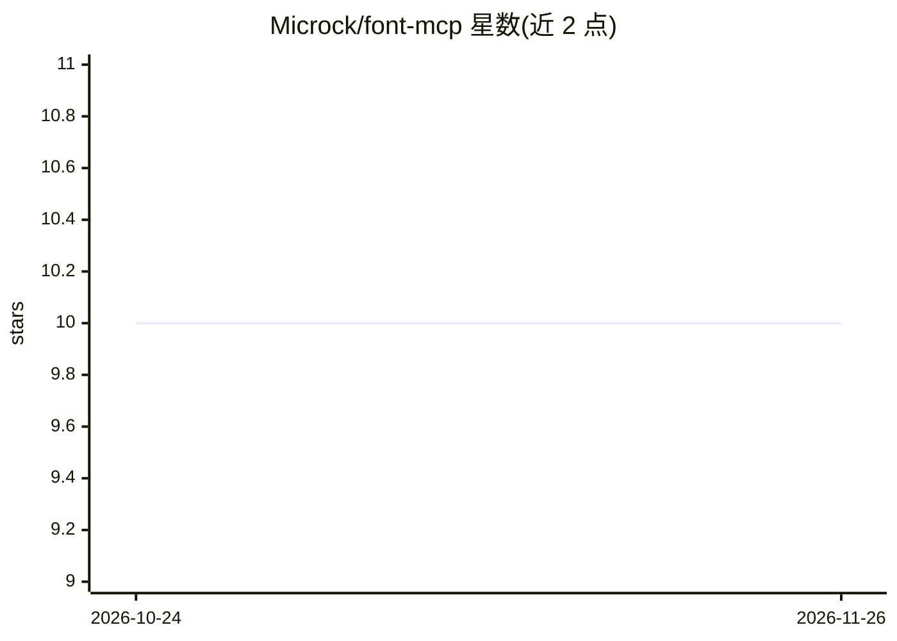

# Microck/font-mcp

⭐ 10 · TypeScript · 推送 2026-11-18 · [GitHub](https://github.com/Microck/font-mcp) · 个人维护

**MCP 字体设计顾问服务器：研究并推荐适配项目的字体**

一个 MCP 服务器，通过四个工具为项目提供字体服务：根据项目气质描述实时检索 Reddit（r/typography、r/web_design）与 Typewolf、FontsInUse 等站点获取字体建议；扫描 package.json 与配置文件自动判定项目风格并推荐；解析任意网站 URL 识别其使用的字体及是否付费；生成 Tailwind 或 CSS 配置并自动下载字体文件。依赖 Node.js 18+，从源码构建运行，需配合 MCP 客户端（如 OpenCode、Codex）使用。

## 筛选速览

| 维度 | 判定 | 备注 |
|---|---|---|
| AI 角色 | `ai-ecosystem` | LLM/agent 周边工具 |
| 许可风险 | `permissive` | — |
| 部署形态 | `library` | 以包/库形式分发 |
| 模型依赖 | — | README 未给出锁定关系 |
| 硬件要求 | — | 无带数字的原话,不猜 |
| 安装摩擦 | `low` | 无编译、无系统依赖或容器化 |
| 成熟度 | — | 结构信号不足 |

## 能力要点

- 实时检索 Reddit、Typewolf、FontsInUse 获取字体用法与推荐
- 扫描 package.json 与配置文件自动检测项目风格与技术栈
- 解析网站 URL 反查其使用的字体及付费/免费属性
- 生成 Tailwind/CSS 配置并经多策略渠道自动下载字体文件

## 适用场景

- 为新项目按视觉气质挑选并搭配字体
- 仿制某网站的字体排版方案
- 自动生成并落地 Tailwind 字体配置与字体文件

## 场景标签

 · 领域:设计/前端开发工具

## 证据(README 行号)

> L5:  MCP Server
> L7: An expert design advisor MCP server that finds, pairs, and sets up the best fonts for your project.

## 星数曲线

2026-10-24 10 → 2026-11-26 10（+0）

---
*卡片 v1 · prompt 1.4 · 生成 2026-11-20 · 置信度 mid · 依据 README sha `0f0ae1c0dcb3` · [字段定义](../../DATASET.md)*
