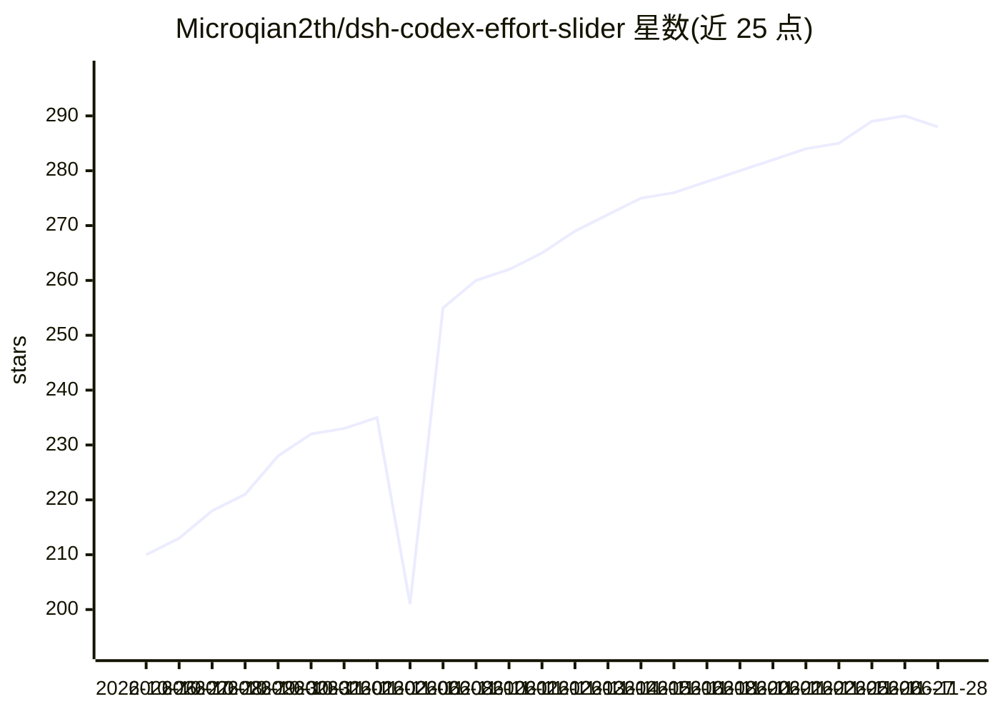

# Microqian2th/dsh-codex-effort-slider

⭐ 288 · JavaScript · MIT · 推送 2026-11-18 · [GitHub](https://github.com/Microqian2th/dsh-codex-effort-slider) · 个人维护 · 中文 README

**给 DSH 桌面端加推理等级滑条的界面插件**

DeepSeek Harness（DSH）的界面插件：不新增入口，直接在官方模型菜单的「推理等级」一行内注入可拖动的连续滑条，并带高档位渐变、星云与星尘粒子特效。通过 DOM 语义属性锚点定位，经官方同一写入口读写档位，任何识别失败即静默退回（fail-open）。支持 npm、插件面板、本地路径与脚本多种安装方式；零运行时依赖、无构建步骤，需重启 DSH Desktop 生效。面向 DSH 用户调节推理档位。

## 筛选速览

| 维度 | 判定 | 备注 |
|---|---|---|
| AI 角色 | `ai-enhanced` | 去掉 AI 部分产品仍成立 |
| 许可风险 | `permissive` | MIT |
| 部署形态 | `library` | 以包/库形式分发 |
| 模型依赖 | locked-api |  |
| 硬件要求 | — | 无带数字的原话,不猜 |
| 安装摩擦 | `low` | 无编译、无系统依赖或容器化 |
| 成熟度 | — | 结构信号不足 |

## 能力要点

- 拖动即时切换推理档位，滑过边界即切档
- 一档一色渐变 + 高档位星云与星尘粒子特效
- 仅依赖官方语义属性锚点，fail-open 不破坏官方界面
- 272 项离线断言测试套件

## 适用场景

- 在 DSH 桌面端用滑条快速切换推理档位
- 个性化美化模型菜单的档位显示
- 反馈问题时导出逐帧诊断记录

## 场景标签

 · 领域:AI 客户端插件/界面增强

## 证据(README 行号)

> L5: 给 DeepSeek Harness（DSH）用的 **Codex 风格推理等级滑条**。
> L45: 它不新增入口：**直接改造官方模型菜单里的「推理等级」那一行** ——

## 星数曲线

2026-10-26 210 → 2026-11-28 288（+78）

---
*卡片 v1 · prompt 1.4 · 生成 2026-11-25 · 置信度 high · 依据 README sha `eed397c18936` · [字段定义](../../DATASET.md)*
